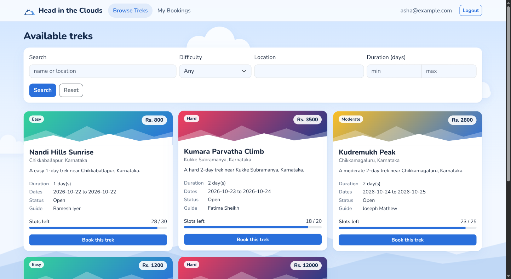
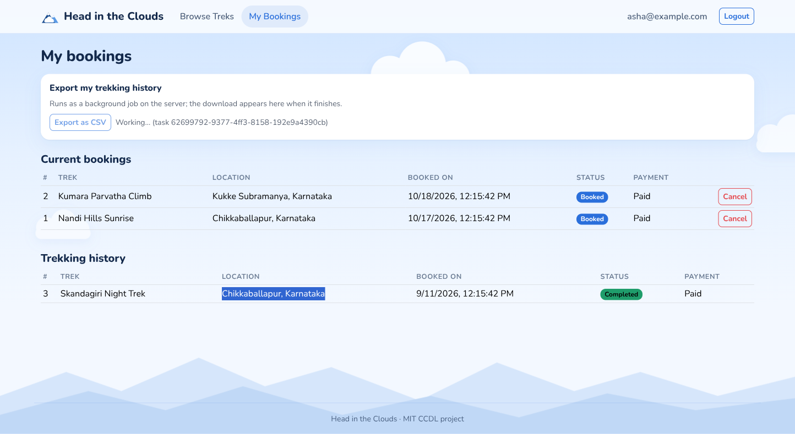

# Head in the Clouds: Deploying a Trek Booking Platform on Microsoft Azure

Cloud Computing and DevOps Lab (CCDL) report, academic year 2026-27

| | |
| --- | --- |
| Students | Navon John Lukose (240905602), Srishti Sudesh (240905626) |
| Section and batch | CSE C, batch 2 |
| Institute | Manipal Institute of Technology |
| Department | School of Computer Engineering |
| Supervisor | Mohandas Shenoy P |
| Live deployment | https://hitc602.centralindia.cloudapp.azure.com |

## Aim

To deploy Head in the Clouds, a Flask and Vue trek booking application with
background jobs, on Microsoft Azure using managed services and Azure
Kubernetes Service, provisioned from the Azure CLI and described again as
Bicep infrastructure as code.

## Objectives

1. Provision a virtual network, a container registry, a Kubernetes cluster and
   a private PostgreSQL server with `az` commands.
2. Add the supporting managed services: Azure Managed Redis, a Service Bus
   queue, Blob Storage, Key Vault and a managed identity federated with the
   cluster.
3. Build the container image, push it to Azure Container Registry, and deploy
   it to AKS with Helm, with every secret coming from Key Vault.
4. Expose the application over HTTPS with the AKS application routing add-on.
5. Replace the Celery beat scheduler with timer-triggered Azure Functions, and
   add alerts.
6. Describe the infrastructure in Bicep and check it against the live
   deployment with `az deployment group what-if`.
7. Ship a code change to the running system in under five minutes.

## Tools and environment

| Item | Version or value |
| --- | --- |
| Azure subscription | Azure for Students, region Central India |
| Azure CLI | 2.90.0, extensions `redisenterprise` and `front-door` |
| Bicep CLI | 0.48.1 |
| Kubernetes on AKS | 1.36 |
| kubectl, Helm | 1.36, 4.3.1 (pinned in `mise.toml`) |
| Podman | for building the image locally |
| PostgreSQL | 17, Azure Database for PostgreSQL flexible server |
| Application | Python 3.13, Flask 3.1, Celery 5.6, Vue 3, Vite 8 |

All provisioning lives in `deploy/azure/` as six numbered scripts. Each one
prints every command it runs and Azure's reply into `deploy/azure/logs/`, with
generated passwords and keys replaced by `<redacted>`. The command listings
below are taken from those logs, shortened where marked.

## Architecture



| Concern | Azure service in the lab | Tier |
| --- | --- | --- |
| Compute | Azure Kubernetes Service, 1 to 2 `Standard_B2s_v2` nodes, cluster autoscaler | free control plane |
| Ingress and TLS | AKS application routing add-on (managed NGINX), Let's Encrypt certificate via cert-manager | free |
| Relational data | Azure Database for PostgreSQL flexible server 17, private access only | B1ms, 12-month free services |
| Cache and job results | Azure Managed Redis | Balanced B0, smallest |
| Job queue | Azure Service Bus queue with dead-lettering | Basic |
| Scheduled jobs | Azure Functions, timer triggers | Flex Consumption, free grant |
| Static front end and exports | Azure Blob Storage, static website plus an `exports` container | Standard LRS |
| Secrets | Azure Key Vault, read through the Secrets Store CSI driver | Standard |
| Pod identity | Microsoft Entra Workload ID with a user-assigned managed identity | free |
| Images | Azure Container Registry | Basic |
| Logs and alerts | Azure Monitor, Container Insights, Log Analytics with a daily cap | inside the free 5 GB a month |

A browser request reaches the ingress controller's load balancer at
`hitc602.centralindia.cloudapp.azure.com`. Paths under `/api` go to the
`trek-api` pods; every other path is proxied to the static website in Blob
Storage, and page routes are rewritten to `index.html` so deep links work. The
API reads and writes PostgreSQL over the virtual network, caches listings in
Redis, and puts slow work on the Service Bus queue. Celery workers on AKS take
jobs from that queue. Timer-triggered Functions add the daily and monthly jobs
to the same queue, so the cluster runs no scheduler process.

No credential is stored in the image, the Helm chart or the cluster's
configuration. The pods present a Kubernetes service account token, Entra ID
exchanges it for a token of the `hitc-workload` managed identity, and that
identity is what Key Vault and Blob Storage authorise.

## Procedure

### Step 1: foundation (`01-foundation.sh`)

```
$ az group create --name hitc-rg --location centralindia \
    --tags project=head-in-the-clouds course=CCDL -o table
Location      Name
------------  -------
centralindia  hitc-rg

$ az network vnet create --resource-group hitc-rg --name hitc-vnet \
    --address-prefix 10.20.0.0/16 --subnet-name aks --subnet-prefixes 10.20.0.0/22
$ az network vnet subnet create --resource-group hitc-rg --vnet-name hitc-vnet \
    --name postgres --address-prefixes 10.20.8.0/24 \
    --delegations Microsoft.DBforPostgreSQL/flexibleServers

$ az acr create --resource-group hitc-rg --name hitc602acr --sku Basic -o table
NAME        RESOURCE GROUP    LOCATION      SKU    LOGIN SERVER
----------  ----------------  ------------  -----  ---------------------
hitc602acr  hitc-rg           centralindia  Basic  hitc602acr.azurecr.io

$ az monitor log-analytics workspace create --resource-group hitc-rg \
    --workspace-name hitc-logs --retention-time 30 --quota 0.15
```

The cluster is created with workload identity, KEDA, Container Insights and
the Key Vault CSI driver turned on, inside the `aks` subnet, with pull access
to the registry:

```
$ az aks create --resource-group hitc-rg --name hitc-aks --location centralindia \
    --tier free --node-vm-size Standard_B2s_v2 --node-count 1 \
    --enable-cluster-autoscaler --min-count 1 --max-count 2 \
    --network-plugin azure --network-plugin-mode overlay --vnet-subnet-id <aks subnet> \
    --enable-oidc-issuer --enable-workload-identity --enable-keda \
    --enable-addons monitoring,azure-keyvault-secrets-provider --enable-secret-rotation \
    --workspace-resource-id <hitc-logs> --attach-acr hitc602acr --no-ssh-key
```

PostgreSQL gets an address in the delegated subnet and registers in a private
DNS zone linked to the network, so it has no public endpoint at all:

```
$ az network private-dns zone create --resource-group hitc-rg \
    --name hitcdb.private.postgres.database.azure.com
$ az network private-dns link vnet create --resource-group hitc-rg \
    --zone-name hitcdb.private.postgres.database.azure.com \
    --name hitc-vnet-link --virtual-network hitc-vnet --registration-enabled false
$ az postgres flexible-server create --resource-group hitc-rg --name hitc602-pg \
    --location centralindia --version 17 --tier Burstable --sku-name Standard_B1ms \
    --storage-size 32 --backup-retention 7 --vnet hitc-vnet --subnet postgres \
    --private-dns-zone <zone id> --admin-user hitcadmin --admin-password <redacted> --yes
$ az postgres flexible-server db create --resource-group hitc-rg \
    --server-name hitc602-pg --name hitc

$ az postgres flexible-server show --resource-group hitc-rg --name hitc602-pg \
    --query '{name:name, version:version, sku:sku.name, state:state,
             publicAccess:network.publicNetworkAccess}'
Name        Version    Sku            State    PublicAccess
----------  ---------  -------------  -------  --------------
hitc602-pg  17         Standard_B1ms  Ready    Disabled

$ az aks show --resource-group hitc-rg --name hitc-aks --query '{...}' -o table
Name      K8s    State      Nodes    Size
--------  -----  ---------  -------  ---------------
hitc-aks  1.36   Succeeded  2        Standard_B2s_v2
```

### Step 2: managed services and identity (`02-services.sh`)

```
$ az redisenterprise create --resource-group hitc-rg --name hitc602-redis \
    --location centralindia --sku Balanced_B0 --public-network-access Enabled --no-database
$ az redisenterprise database create --resource-group hitc-rg --cluster-name hitc602-redis \
    --client-protocol Encrypted --port 10000 --clustering-policy EnterpriseCluster \
    --eviction-policy VolatileLRU --access-keys-auth Enabled

$ az servicebus namespace create --resource-group hitc-rg --name hitc602bus \
    --location centralindia --sku Basic
$ az servicebus queue create --resource-group hitc-rg --namespace-name hitc602bus \
    --name celery --max-delivery-count 5 --lock-duration PT5M \
    --enable-dead-lettering-on-message-expiration true

$ az storage account create --resource-group hitc-rg --name hitc602st \
    --sku Standard_LRS --kind StorageV2 --min-tls-version TLS1_2 --allow-blob-public-access false
$ az storage blob service-properties update --static-website \
    --index-document index.html --404-document index.html
$ az storage container create --name exports
$ az storage account management-policy create --resource-group hitc-rg \
    --account-name hitc602st --policy @exports-lifecycle.json
```

The lifecycle policy deletes exports a week after they are written. Key Vault
uses Azure RBAC, and the managed identity is granted only what it needs:

```
$ az keyvault create --resource-group hitc-rg --name hitc602-kv \
    --enable-rbac-authorization true --retention-days 7
$ az identity create --resource-group hitc-rg --name hitc-workload
$ az role assignment create --assignee-object-id <hitc-workload> \
    --assignee-principal-type ServicePrincipal --role "Key Vault Secrets User" --scope <hitc602-kv>
$ az role assignment create --assignee-object-id <hitc-workload> \
    --assignee-principal-type ServicePrincipal --role "Storage Blob Data Contributor" --scope <hitc602st>

$ az identity federated-credential create --resource-group hitc-rg \
    --identity-name hitc-workload --name hitc-k8s \
    --issuer https://centralindia.oic.prod-aks.azure.com/<tenant>/<cluster>/ \
    --subject system:serviceaccount:hitc:hitc --audiences api://AzureADTokenExchange
```

The federated credential is the trust link: a token that the cluster's OIDC
issuer mints for the `hitc` service account in the `hitc` namespace can be
exchanged for this identity, and no other token can. The connection strings
are then written to Key Vault:

```
$ az keyvault secret set --vault-name hitc602-kv --name database-url --value <redacted>
...
$ az keyvault secret list --vault-name hitc602-kv \
    --query '[].{name:name, enabled:attributes.enabled}' -o table
Name                    Enabled
----------------------  ---------
admin-password          True
celery-broker-url       True
database-url            True
gchat-webhook-url       True
redis-url               True
secret-key              True
security-password-salt  True
servicebus-connection   True
```

### Step 3: build and deploy (`03-deploy.sh`)

The image is built with Podman and pushed with a short-lived registry token
from `az acr login --expose-token`. The front end is uploaded to the
`$web` container, and the Helm chart in `deploy/helm/hitc` is installed:

```
$ podman build --platform linux/amd64 -t hitc602acr.azurecr.io/hitc-api:<tag> .
$ podman push hitc602acr.azurecr.io/hitc-api:<tag>
$ az storage blob upload-batch --destination '$web' --source frontend/dist --overwrite
$ az aks get-credentials --resource-group hitc-rg --name hitc-aks
$ helm upgrade --install hitc deploy/helm/hitc --namespace hitc \
    --set image.repository=hitc602acr.azurecr.io/hitc-api --set image.tag=<tag> \
    --set azure.workloadClientId=<hitc-workload client id> --set azure.keyVaultName=hitc602-kv \
    --set azure.exportBlobAccountUrl=https://hitc602st.blob.core.windows.net/ --wait
```

The chart holds the API Deployment with a HorizontalPodAutoscaler and a
PodDisruptionBudget, the Celery worker Deployment with a KEDA ScaledObject on
the Service Bus queue, a SecretProviderClass that mirrors the Key Vault
secrets into the pods, and a `db-init` Job that creates the schema as a Helm
hook before each release.

### Step 4: HTTPS edge (`04-edge.sh`)

```
$ az aks approuting enable --resource-group hitc-rg --name hitc-aks
$ az aks approuting update --resource-group hitc-rg --name hitc-aks --nginx None
$ helm install cert-manager oci://quay.io/jetstack/charts/cert-manager --version v1.21.2 \
    --namespace cert-manager --create-namespace --set crds.enabled=true
$ helm upgrade hitc deploy/helm/hitc --namespace hitc --reuse-values \
    --set edge.enabled=true --set edge.host=hitc602.centralindia.cloudapp.azure.com \
    --set edge.webHost=hitc602st.z29.web.core.windows.net

$ kubectl -n hitc get ingress,certificate
NAME          CLASS       HOSTS                                     ADDRESS           PORTS
api           hitc-edge   hitc602.centralindia.cloudapp.azure.com   135.235.188.204   80, 443
api-booking   hitc-edge   hitc602.centralindia.cloudapp.azure.com   135.235.188.204   80, 443
api-login     hitc-edge   hitc602.centralindia.cloudapp.azure.com   135.235.188.204   80, 443
web           hitc-edge   hitc602.centralindia.cloudapp.azure.com   135.235.188.204   80, 443
web-assets    hitc-edge   hitc602.centralindia.cloudapp.azure.com   135.235.188.204   80, 443

NAME                                   READY   SECRET
certificate.cert-manager.io/hitc-tls   True    hitc-tls

$ curl https://hitc602.centralindia.cloudapp.azure.com/api/health
{"status":"ok"}
```

The `api-login` and `api-booking` ingresses carry NGINX rate limits of 20 and
30 requests per minute per client IP. The `--nginx None` update removes the
add-on's default controller, because the chart brings its own and the default
one alone requests a full CPU.

### Step 5: scheduled jobs and monitoring (`05-jobs-and-monitoring.sh`)

```
$ az functionapp create --resource-group hitc-rg --name hitc602-func \
    --storage-account hitc602st --flexconsumption-location centralindia \
    --runtime python --runtime-version 3.13 --instance-memory 512 --assign-identity '[system]'
$ az functionapp config appsettings set --resource-group hitc-rg --name hitc602-func \
    --settings "CELERY_BROKER_URL=@Microsoft.KeyVault(VaultName=hitc602-kv;SecretName=celery-broker-url)"
$ az functionapp deployment source config-zip --resource-group hitc-rg --name hitc602-func \
    --src functions.zip --build-remote true

$ az functionapp function list --resource-group hitc-rg --name hitc602-func -o table
Name                          Trigger       Schedule
----------------------------  ------------  -------------
hitc602-func/daily_reminders  timerTrigger  0 30 12 * * *
hitc602-func/monthly_report   timerTrigger  0 30 0 1 * *

$ az monitor action-group create --resource-group hitc-rg --name hitc-oncall \
    --short-name hitconcall --action email oncall <student e-mail>
$ az monitor metrics alert create --resource-group hitc-rg --name hitc-dead-letters \
    --scopes <hitc602bus> --condition "max DeadletteredMessages > 0" \
    --window-size 5m --evaluation-frequency 5m --severity 2 --action <hitc-oncall>
...
$ az monitor metrics alert list --resource-group hitc-rg -o table
Name                Severity    Enabled    Description
------------------  ----------  ---------  ----------------------------------------------------------------------
hitc-dead-letters   2           True       A job failed five times and was dead-lettered
hitc-queue-backlog  2           True       Workers are not keeping up with the job queue
hitc-db-storage     2           True       PostgreSQL storage above 80 percent
hitc-node-cpu       2           True       AKS nodes above 80 percent CPU; the autoscaler should be adding a node
```

Functions on Linux run cron expressions in UTC, so 12:30 UTC is 18:00 in
India. The Function app reads the broker URL from Key Vault through a Key
Vault reference and its own managed identity.

### Step 6: the same infrastructure in Bicep (`06-bicep-what-if.sh`)

`deploy/bicep/main.bicep` declares the network, private DNS zone, registry,
log workspace, AKS, PostgreSQL, Redis, Service Bus, storage, Key Vault,
managed identity and federated credential, action group and alerts. It is
compiled and checked against the live resource group without deploying:

```
$ az bicep build --file deploy/bicep/main.bicep --outfile main.json
$ az deployment group validate --resource-group hitc-rg \
    --template-file deploy/bicep/main.bicep --parameters pgAdminPassword=<redacted> alertEmail=<e-mail>
Succeeded
$ az deployment group what-if --resource-group hitc-rg \
    --template-file deploy/bicep/main.bicep --parameters ...
Note: The result may contain false positive predictions (noise).

  ~ Microsoft.ContainerService/managedClusters/hitc-aks [2026-05-01]
    ~ properties.agentPoolProfiles: [
      ~ 0:
        ~ count: 2 => 1
      ]
  ~ Microsoft.Network/virtualNetworks/hitc-vnet [2024-05-01]
    - properties.privateEndpointVNetPolicies: "Disabled"
  ~ Microsoft.ServiceBus/namespaces/hitc602bus/queues/celery [2024-01-01]
    - properties.defaultMessageTimeToLive: "P14D"
    - properties.maxSizeInMegabytes:       1024
  ...
Resource changes: 9 to modify.
```

What-if compared 23 resources and found nothing to create and nothing to
delete, which means every resource the scripts made is described by the
template. Of the nine it reports as modified, only one carries a real
difference. The node count reads 2 in Azure and 1 in the template, because
the cluster autoscaler added the second node after creation. The other lines
are properties Azure filled in with defaults that the template leaves unset,
which a deployment would not change, and values such as the OIDC issuer URL
that what-if cannot resolve until a deployment runs. Five resources were
ignored because the template does not declare them: the Function app, its
plan and the Application Insights instance Azure created alongside it.

### Rolling out a change (`rollout.sh`)

```
$ ./deploy/azure/rollout.sh
front end changed; rebuilding in the background
$ podman build ... && podman push hitc602acr.azurecr.io/hitc-api:2dcfb2e-20261021175238
$ helm upgrade hitc deploy/helm/hitc --namespace hitc --reuse-values \
    --set image.tag=2dcfb2e-20261021175238 --wait --timeout 4m
Release "hitc" has been upgraded. Happy Helming!
$ kubectl -n hitc rollout status deploy/trek-api --timeout 60s
deployment "trek-api" successfully rolled out
$ curl https://hitc602.centralindia.cloudapp.azure.com/api/health
{"status":"ok"}

rollout of 2dcfb2e-20261021175238 finished in 70s
```

Podman reuses its cached dependency layer, so a code change pushes one small
layer. Helm rolls the API one pod at a time (`maxUnavailable: 0`) behind its
readiness probe on `/api/health`, which fails when the database is
unreachable, so a new pod takes traffic only once it can serve.

## Results

### State of the cluster

```
$ kubectl -n hitc get deploy,pods,hpa,scaledobject
NAME                          READY   UP-TO-DATE   AVAILABLE
deployment.apps/trek-api      2/2     2            2
deployment.apps/trek-worker   1/1     1            1

NAME                               READY   STATUS
pod/trek-api-b97f7bd45-2pmb4       1/1     Running
pod/trek-api-b97f7bd45-99dsz       1/1     Running
pod/trek-worker-7b56b7f8fc-qpzlj   1/1     Running

NAME                                                       TARGETS       MINPODS   MAXPODS
horizontalpodautoscaler.autoscaling/keda-hpa-trek-worker   0/5 (avg)     1         6
horizontalpodautoscaler.autoscaling/trek-api               cpu: 1%/70%   2         10

NAME                               MIN   MAX   READY   TRIGGERS
scaledobject.keda.sh/trek-worker   1     6     True    azure-servicebus
```

### Functional checks on the live deployment

| Check | Result |
| --- | --- |
| `GET /api/health` over HTTPS | `{"status":"ok"}`, Let's Encrypt certificate valid |
| Front end and deep links (`/`, `/login`, `/treks`) | HTTP 200, served from Blob through the ingress |
| Trekker login and trek listing | works against PostgreSQL over the private network |
| CSV export | queued on Service Bus, run by the worker in 1.0 s, uploaded to Blob Storage with the workload identity |
| Export download | read-only SAS link to the blob, expiring after 15 minutes |
| Another user's export | HTTP 403 |
| Timer function `daily_reminders`, invoked manually | message on Service Bus, worker reported 3 upcoming treks and 6 reminders sent |
| Code rollout | 70 s from build to healthy, no downtime |



The worker log for the export and the reminder run:

```
Task app.tasks.export_bookings_csv[9fe2b990-...] received
[export] wrote blob bookings-user5-20261021-121600.csv (3 rows)
Task app.tasks.export_bookings_csv[9fe2b990-...] succeeded in 1.03s: {'filename': ..., 'rows': 3}

Task app.tasks.send_daily_reminders[2a2135ee-...] received
[reminders] 3 upcoming trek(s), 6 reminder(s) sent
Task app.tasks.send_daily_reminders[2a2135ee-...] succeeded in 5.89s: {'upcoming_treks': 3, 'reminders_sent': 6}
```

## Cost and free tiers

Prices are Central India pay-as-you-go list prices from the Azure Retail
Prices API, charged against the Azure for Students credit.

| Resource | Tier | Approximate cost |
| --- | --- | --- |
| AKS control plane | Free | 0 |
| AKS nodes, `Standard_B2s_v2` | 1 to 2 nodes | 0.090 USD per node-hour |
| PostgreSQL `Standard_B1ms`, 32 GB | 12-month free services | 0 |
| Azure Managed Redis | Balanced B0 | 0.017 USD per hour |
| Container Registry | Basic | 0.167 USD per day |
| Public IP for the ingress | Standard | 0.005 USD per hour |
| Service Bus | Basic | per operation, a few cents |
| Functions | Flex Consumption | inside the monthly free grant |
| Log Analytics | 0.15 GB daily cap | inside the free 5 GB a month |
| Blob Storage, Key Vault | Standard | a few cents |

With one node the lab runs at roughly 3 USD a day. Between demonstrations the
cluster and the database are stopped, which removes the node and database
compute charges:

```
$ az aks stop --resource-group hitc-rg --name hitc-aks
$ az postgres flexible-server stop --resource-group hitc-rg --name hitc602-pg
```

## Problems faced

The Azure for Students offer blocks several services, and each one changed
the plan.

1. **Front Door is not available.** `az afd profile create` returned "Free
   Trial and Student account is forbidden for Azure Frontdoor resources". The
   edge became the AKS application routing add-on with a Let's Encrypt
   certificate, and NGINX rate limits replaced the WAF rules.
   `deploy/azure/optional-front-door.sh` keeps the Front Door version for a
   pay-as-you-go subscription.
2. **ACR Tasks are not available.** `az acr build` returned
   `TasksOperationsNotAllowed`, so the image is built locally with Podman and
   pushed with a token from `az acr login --expose-token`. The local layer
   cache also made rollouts faster.
3. **Most general-purpose VM sizes are restricted** in Central India zones 1
   and 3 for this subscription. `az vm list-skus` showed the restriction, and
   the cluster was created without pinning zones so it lands in an allowed one.
4. **Six regional vCPUs.** The add-on's default NGINX controller requested a
   full CPU and left the second API pod unschedulable, with the autoscaler
   already at its two-node limit. Removing the default controller with
   `az aks approuting update --nginx None` freed the capacity.
5. **Budgets through the API** are rejected for this offer, so cost is
   controlled by stopping the cluster and the database between sessions.

Two CLI behaviours also needed care. `az postgres flexible-server create` no
longer creates the private DNS zone itself, so the zone and its network link
are created first and passed in by resource ID. And Celery 5.6 has no
`azureservicebus` extra; installing `celery[azureservicebus]` silently skips
the Azure SDK, so `azure-servicebus` is listed as a direct dependency.

## Conclusion

The application runs on Azure entirely from managed services and AKS, with no
secret stored in code, images or cluster configuration. Every resource was
created from the Azure CLI, the same infrastructure is described in Bicep and
validated against the live deployment, and a code change reaches production
in about a minute without downtime. The student subscription's restrictions
replaced Front Door and ACR Tasks with in-cluster equivalents, but each
replacement is itself an Azure feature, and the design keeps the managed
versions available for a subscription that allows them.
