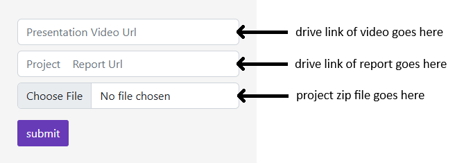
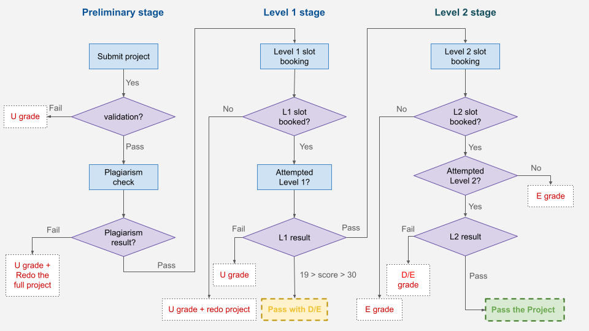

# MAD - 2 Project and Viva Instructions (T22026)

Source: <https://docs.google.com/document/u/1/d/e/2PACX-1vTKQBIsllAp4VUq_rST3_rbpMSoADyfb3agZ1E-jrGQxMeN2lBNOXu3GS0mchzRWaxWa204q52tbFYA/pub>

---

[MAD - 2 Project and Viva Instructions (T22026)](#h.obbtgknmlrdo)

[Malpractice guidelines for the students (Very Important)](#h.jhodnmkyjyse)

[1. Declaration of Ownership:](#h.6c1eli8y63bl)

[2. Identification of Malpractice in Project Viva:](#h.do3d8gwyuc6a)

[How to ensure the code you are submitting will work when we evaluate it](#h.gnrjoxlyrw34)

[How to submit your final project:](#h.syodygyew1h5)

[How we will evaluate your submitted project:](#h.s8394fh017uf)

[Step 1: Executing the submission.](#h.mmw7t87lqka4)

[Step 2: If the validation fails](#h.tvuhgc3js5z1)

[Step 3: If the validation passes but fails the plagiarism test](#h.8nf0f07thn5c)

[Step 4: If your submission is valid and has passed the plagiarism checker](#h.7tc71c4lpork)

[Step 5a: If the student is eligible for L1 viva but does not book a slot](#h.cezsqm259cxz)

[Step 5b: If a student fails Level 1 viva (marks < 20)](#h.jjplnedxr50o)

[Step 5c: If you pass Level 1 viva (20 ≤ marks obtained < 30)](#h.jd5roiper54)

[Step 5d: If you pass Level 1 viva (marks obtained ≥ 30)](#h.ks35cfjg1s78)

[Step 6a: If the student is eligible for L2 viva but does not book L2 slot](#h.j3gp17eeknk7)

[Step 6b: If you fail Level 2 viva (0 < marks obtained < 20)](#h.udkeeew6fnjw)

[Step 6c: If you pass Level 2 viva (marks obtained ≥ 20)](#h.ctjkwi29yq0h)

[Student behaving rudely with the examiner (level 1 or level 2)](#h.fjk9pczhn0s9)

[Flowchart for Viva workflow](#h.xed1vxi8vdvx)

[Score weightage and minimum pass score](#h.gw4cahwxg6on)

[Problem Statement:](#h.sgvjukddpcz8)

[Important Additional Documents:](#h.dkx7949hpma6)

[Deadline-wise bonus scheme:](#h.3v8j5xta9u5w)

[Tentative Timeline for Level 1 & Level 2 viva’s:](#h.bvee5vfvktb1)

[Dos AND Don'ts while attending the viva](#h.txg4p9azhe4a)

[Code Sharing & Plagiarism Guidelines](#h.wv2jluofm8fo)

[Bootcamp Schedule (May Term 2026)](#h.e0902p4c2bjd)

[How to choose?](#h.exisz0n92gtf)

[Offline Bootcamp Travel & Stay Guidelines](#h.jf2ujkwxkvav)

## Malpractice guidelines for the students (Very Important)

This section outlines the expectations, evaluation criteria, and conditions under which a student may be flagged for malpractice in project-based assessments, and how this differs from malpractice in OPPEs.

### 1. Declaration of Ownership:

### Upon submitting the project, you explicitly declare that the project has been developed by you and you possess a clear understanding of the implementation, logic, and concepts used in the project. Failure to demonstrate this during the viva may lead to malpractice consideration.

### 2. Identification of Malpractice in Project Viva:

### A student may be flagged as a potential malpractice case under the following conditions:

#### 2.1 Mismatch Between Project Complexity and Understanding

Demonstrating a highly complex project (advanced UI, libraries, architecture) but failing to answer basic questions related to your own code, project flow and core concepts used

#### 2.2 Inability to Answer Basic Coding Questions

Examiners may ask basic, relevant coding questions derived directly from your project. These questions are within the technical scope of your submission If you are unable to write simple logic, modify your own code, explain existing implementation, you may be flagged for malpractice.

#### 2.3 Academic and Professional Conduct

You are expected to maintain Respectful communication with instructors, examiners, and operations team. Rude behavior, Argumentative or non-cooperative conduct Disrespectful language will directly lead to malpractice.

3. Malpractice statistics from Jan 2026

| Sr. No. | No. of students flagged | Punishment and Grade |
| --- | --- | --- |
| 1 | 15 (violating 2.2) | U grade in project with stern warning |
| 2 | 19 (violating 2.1, 2.2 & 2.3) | U grade in all courses registreted  + 2 term ban from registrations |

Note: once students are flagged for malpractice and send to DWC, its final, no changes will be done in the course grade.

Students are required to go through the malpractice guidelines document in detail to understand the rules for malpractice

[Malpractice guidelines document](https://docs.google.com/document/d/e/2PACX-1vTyPVSy4VJ7I2HVYQh_raS2cBXdL-Z7pGzc3AMKHwxnvFU66o_len_DWZmwXl05YkJmxmNoRQQnJ8le/pub)

## How to ensure the code you are submitting will work when we evaluate it

1. The project can be submitted only once inside the project submission portal.
2. Make sure you first validate your submission using a validation Google form which we have provided inside the project submission portal.
3. You shall receive an automated email after submitting the project file in the validation Google form in a couple of minutes. The validation Google Form can be used as many times as needed.
4. Submit only if the project zip folder passes the validation check.
5. Once submitted, you will be evaluated based on that submission only.

## How to submit your final project:

1. The project code must be submitted as a zip file.
2. The report must be submitted in a DOCX or PDF format
3. The video must not be more than 5-10 minutes in length

All of the above must be submitted in their respective fields only

* Kindly note that there should not be any other file or folder in the root directory except the project folder.
* A probable file tree structure is given below.
* 

## How we will evaluate your submitted project:

### Step 1: Executing the submission.

Once we receive the submission, we will batch process the received submissions after the deadline, using an automated code, which will first unzip the folder, look for presence of the root folder and existence of a Python file.

If the submission has all the required files, it is considered valid.

### Step 2: If the validation fails

If the folder cannot be unzipped or the root folder or .py file is missing, the submission will be reported as invalid.

Following are the possible scenarios where your submission will be considered as invalid:

* It is not a zip file.
* The project folder does not reside in the root directory of the zip submission folder.
* There are other files or folders in the root directory other than the project folder.
* The files/folders of the application are not inside the project folder.
* Submission does not contain any ‘.py’ file.
* The submission contains only PDF/text files.
* The compiler is unable to unzip your submission.
* Your submission contains corrupted files (files with unrecognized extensions).
* Any additional scenario where we are unable to process your submission.

Note: After a successful submission, students are expected to download the submission from the portal itself and check if the submission contains all the files.

### Step 3: If the validation passes but fails the plagiarism test

If the submission passes validation, it goes through the plagiarism checker. If your submission is reported as failed by the plagiarism checker, we will inform you of this. If you wish to contest this, you can fill out the grievance redressal form and the internal grievance committee will review this.

If plagiarism is proven, the submitted file will no longer be considered for the evaluation and the student shall get U grade in project for that term. Students are required to maintain a proper GitHub history as a proof of originality of their work.

Note: The grievance redressal form will only be provided to the student failing the plagiarism test through plagiarism checker, and NOT to those who have been marked to have done malpractice by your examiner.

### Step 4: If your submission is valid and has passed the plagiarism checker

You will be eligible to attend Level-1 viva, where an assessment is done to check if the project conforms to the basic requirements given in the project statement and if the student has a basic understanding of the work submitted.

1. The students giving the level 1 viva must be able to run the project within 10 min after the verification of the checksum.

Failing to do so will result in the student failing the viva without further evaluation.

2. In the initial part of the examination, the students will be asked some descriptive questions and/or code-based questions to test the authenticity of the work and understanding of the student in the work they submitted.

If the student cannot answer these questions, the examiner will NOT proceed further with the evaluation and the student shall fail the exam.

3. The final part of the viva will include objective questions to check if the project conforms to the basic requirements given in the project statement

This will be conducted by the IITM viva team.

Note: During the level 1 viva, if the level 1 examiner is not convinced that the project is solely done by the student, the examiner will have the complete right to fail the student, and it will be considered a malpractice and will be liable for punishment as recommended by the DWC, even if most or all core features are implemented.

Note: It is possible that due to the large number of submissions done by the student, the course team will provide a tentative “pass” for plagiarism to all the students. However, this should NOT be considered as final until your level 2 score is pushed onto the portal as it can be revoked in case it is flagged by the plagiarism checker or as malpractice by the L1 examiner. The course team will clearly notify when the tentative results are given.

### Step 5a: If the student is eligible for L1 viva but does not book a slot

If the student who is eligible for level 1 viva must complete their level 1 viva in the same cycle. Student will not be allowed to book for the viva in the next cycle. If the student fails to book for the viva in the same cycle, he/she shall be awarded U grade and will not be considered for the evaluation.

### Step 5b: If a student fails Level 1 viva (marks < 20)

If a student scores less than 20 marks in their level 1 viva, he/she will fail the project and shall be awarded U grade for the project. The student will have to redo the project in the next term.

Note: There is no provision for reattempt if the student fails Level 1 viva for any reason. Students must refrain from mailing to the course team requesting reconsideration or reattempt.

### Step 5c: If you pass Level 1 viva (20 ≤ marks obtained < 30)

If a student scores between 20 and 29 (both inclusive), you will pass the project with a E grade but will not be eligible for attempting the level 2 exam. The grade distribution is given below

M = marks scored by the student in level 1

| Marks Range | Grade provided |
| --- | --- |
| 20 ≤ M < 30 | E |
| M < 20 | U |

### Step 5d: If you pass Level 1 viva (marks obtained ≥ 30)

You will be eligible to attend the Level 2 viva. In this level, the assessment will be on the quality of the project work, the extent of your involvement, your ability to modify the code at various levels, your depth of understanding, and your understanding of the course in general. This level will be conducted by industry experts and course instructors.

### Step 6a: If the student is eligible for L2 viva but does not book L2 slot

If a student who is eligible for level 2 viva does not book a slot for level 2, will be marked as absent for the level 2 and shall receive minimum grade for the project i.e E grade.

### Step 6b: If you fail Level 2 viva (0 < marks obtained < 20)

If a student attempts Level 2 and obtain marks less 20, then you will be D grade for the project. There will not be a reattempt if you fail the level 2 viva.

Note: If a student scores 0 marks or is absent for level 2 viva, will be awarded E grade.

### Step 6c: If you pass Level 2 viva (marks obtained ≥ 20)

Once you successfully complete and pass Level 2 viva, your project course is completed, subject to the clearance of plagiarism checks with all the submissions made in that particular term.

Note: The sum of Level 1 and Level 2 score will only be considered for grade calculation iff the student passes Level 2 viva.

### Student behaving rudely with the examiner (level 1 or level 2)

At any stage, if a student is found to be misbehaving with the examiner or showing any kind of misconduct will straightaway be removed from the viva process and will get a U grade for that term.

Students are expected to maintain the decorum of the project spaces, discourse or while creating discrepancy if applicable.

## Flowchart for Viva workflow

## Score weightage and minimum pass score

|  | Weightage | Pass Percentage | Pass Score |
| --- | --- | --- | --- |
| Level 1 | 40% | 50% | 20/40  (30/40 for L2 Eligibility) |
| Level 2 | 60% | 33% | 20/60 |

* Project Submission Starts:

* Wednesday, June 10th, 2026

* Project Submission Deadline (before May 2026 Theory Completed/Passed):

* Tuesday, July 14th, 2026

* Project Submission Deadline (May 2026 Theory registered):

* Sunday, August 9th, 2026

## Problem Statement:

The problem statement that students have to complete in the May 2026 term will be Anyone given below.

Placement Portal Application - V2

[https://docs.google.com/document/d/e/2PACX-1vTcayCKq8OPAVeTZHXNwCXxvJfiQRcMxiiqXcNmrDkbiSwu9it0SCOkXwTytPy2Hx-p6IAkr6XSF4fB/pub](https://docs.google.com/document/d/e/2PACX-1vTcayCKq8OPAVeTZHXNwCXxvJfiQRcMxiiqXcNmrDkbiSwu9it0SCOkXwTytPy2Hx-p6IAkr6XSF4fB/pub)

Trekking Management Application - V2

[https://docs.google.com/document/d/e/2PACX-1vSabfvSRC1BvxC5eNhzzj6PqBg1ATKq9nH\_s\_fVwOrG84-JNETkFkwienTgnmoAMSZZT9zsHdNwis4Y/pub](https://docs.google.com/document/d/e/2PACX-1vSabfvSRC1BvxC5eNhzzj6PqBg1ATKq9nH_s_fVwOrG84-JNETkFkwienTgnmoAMSZZT9zsHdNwis4Y/pub)

## Important Additional Documents:

Students must go through the following documents to get additional assistance/information for the project.

1. The [Git tracker document](https://docs.google.com/document/d/e/2PACX-1vSQb6y00ELBQ4MC1FAhn1JO8LmVsxGe1ke_aJi8hEIEHYLO8RqHDzl0bxZtxj6J-AYumNrA7jdxRmyu/pub) helps you to create an account on GitHub and the team can easily track your progress.

Note: Registration on Git Tracker is compulsory for all the students, which will serve as the 0th milestone for the project. Failing to do so before the deadline, the project will not be considered for evaluation.

2. A complete list of milestones to guide students in their project development process and help us track your project is given in the document attached below.

        [App Dev II Milestone doc - Trekking Management Application V2](https://docs.google.com/document/d/e/2PACX-1vTMf0j9016-ZTK_CKxMDRVVqqYWdcNgx9XzsIQ4ZY0YFFeQyKYBTaIePVc-LDhhfpLw9F0_QaUA6B_A/pub)

[App Dev II Milestone doc - Placement Portal Application V2](https://docs.google.com/document/d/e/2PACX-1vTac3l7WHhdzZAFMR6HmBKqIzqEs8dF5v43CFSlHM2yuDD07_e1GEFTm4dLgcOUn1VY51W4V9YzWxEf/pub)

3. The [Viva preparation checklist document](https://docs.google.com/document/d/e/2PACX-1vTaa0fYHrRdsuQnHfWwXMFm-OBPZo53Yj1ppBFHyj2HTPVSPLTJyidgWCx8pq2HFLSBlWZBePTRcP9u/pub) helps you with things to be kept in mind before the viva.

## Deadline-wise bonus scheme:

| Theory completed term | Submission date | Evaluation |
| --- | --- | --- |
| Jan 2026 and before | July 14, 2026 | 100 |
| May 2026 | August 9, 2026 | 105 marks and cap it to 100 |

## Tentative Timeline for Level 1 & Level 2 viva’s:

A student’s batch/cycle is determined based on the project submission window and is not predefined.

1. If you have completed/passed the theory before the May 2026 term, you must submit the project by 14th July.
2. If you have completed/passed/completing the theory in May 2026 term, you must submit the project by 9th August.

Only after submission within the applicable deadline will your batch be assigned.

To be added one week before the deadline of every submission window

Note: If there is an extension batch, we will update the deadline and the viva schedule later.

## Dos AND Don'ts while attending the viva

* Keep a soft copy of your ID card ready to share at the start of the viva.
* Check your mic, camera, and screen-sharing beforehand — confirm with the viva observer.
* Keep your code organized and easily accessible for quick modifications during the viva.
* If using a local setup, ensure all dependencies are pre-installed; no installations should happen during the viva.
* Viva time should focus on demonstration, project evaluation, and conceptual understanding.
* A viva slot cannot be changed except for valid medical or approved strong reasons (with proof).
* Reasons like “laptop not working” or “another exam” are not acceptable for rescheduling.
* Cancellation/rescheduling due to your side incurs a ₹1000 fee (examiner honorarium + processing).

## Code Sharing & Plagiarism Guidelines

* Do not share your code with anyone until you receive your final project grade.
* If your code is flagged by the plagiarism checker, all similar submissions will also be flagged — all involved students shall face the same penalty, regardless of who wrote it.
* Do not upload your project to any public repository.
* Do not share your code with others — even during discussions or through files, screenshots, screen share, or any other medium.
* Ensure that the entire business logic is written by you.
* You may refer to official documentation for configuration purposes, but code snippets from external sources are not allowed.
* Be prepared to explain every part of your code — including snippets from official documentation (know their purpose and impact).
* Modifying variable or function names in copied code does not make it original.
* Adding irrelevant or unreachable code to bypass plagiarism detection is not acceptable and will be treated as plagiarism.
* Changing the sequence of code blocks in copied code will still be detected as plagiarism.
* The similarity threshold and minimum code length for plagiarism checks will be decided after submissions; focus on building a clean, original, working application, not on beating the checker.
* Do not get your code written by others (friends, family, or acquaintances). Assistance is allowed only if you can explain and modify the code yourself during viva.
* Use the same system for the entire development and viva process; excuses like “code was on another laptop” will not be accepted.
* If you borrow an idea from an external source, you must cite it, but citation alone does not justify copied or slightly modified code.
* Verbatim copying of code (with or without minor edits) is strictly prohibited and will be treated as plagiarism.

## Bootcamp Schedule (May Term 2026)

| Mode | Bootcamp No. | Dates | Duration | Start Day | End Day |
| --- | --- | --- | --- | --- | --- |
| 🖥️ Online | 1st | 21st June – 30th June | 10 days | Sunday | Tuesday |
| 🖥️ Online | 2nd | 16th July – 25th July | 10 days | Thursday | Saturday |
| 🏫 Offline | 1st | 16th June – 22th June | 7 days | Tuesday | Monday |
| 🏫 Offline | 2nd | 3rd July – 9th July | 7 days | Friday | Thursday |

## How to choose?

* Prefer flexibility and remote learning? → Choose Online Bootcamps
* Want in-person interaction and hands-on sessions? → Go for Offline Bootcamps
* Can I join early? → Try the June sessions
* Need more time to plan? → Consider the July sessions

## Offline Bootcamp Travel & Stay Guidelines

* Students attending offline bootcamps are allowed to:

* Arrive one day before the boot-camp begins.
* Depart one day after the boot-camp ends.

* Extended stays are not permitted beyond this window due to logistical and accommodation constraints.
* Please plan your travel accordingly and make necessary arrangements in advance.
