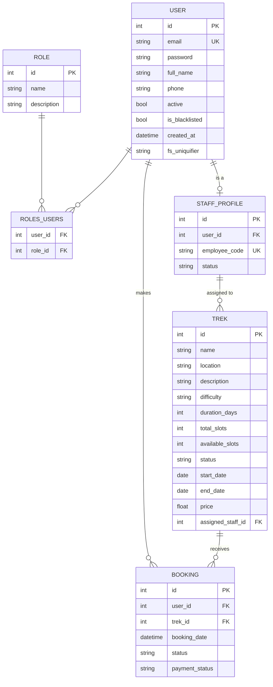

# Trekking Management Application — V2

**Modern Application Development II — Project Report, May 2026 Term**

---

## 1. Student details

| | |
| --- | --- |
| Name | Navon John Lukose |
| Roll number | 24F2003934 |
| E-mail | 24f2003934@ds.study.iitm.ac.in |
| Course | Modern Application Development II (MAD-2) |
| Term | May 2026 |
| Repository | https://github.com/Navonjl/mad2-trekking-management (private) |

---

## 2. Problem statement

Adventure organisations manage treks with spreadsheets, phone calls and manual
coordination, which makes it hard to keep track of trek approvals, participant
registrations, slot availability and bookings.

The task was to build a Trekking Management Application in which three kinds of
user work with the same data through different permissions:

- an **Admin** who creates trek routes, hires staff, assigns staff to treks and
  oversees every user and booking;
- **Trek Staff**, who run only the treks the admin has assigned to them,
  controlling slots and trek status and seeing their participants;
- **Users (Trekkers)**, who register themselves, search the treks on offer,
  book a place and keep a history of where they have been.

## 3. Approach

I built the application as a JSON API with a separate single-page front end,
rather than server-rendered pages, because the same data has to be presented
three different ways. Keeping every rule in the API means the browser cannot
skip a check, and the three dashboards become three sets of components reading
one set of endpoints.

Four decisions shaped the rest of the work.

**One user table for all three roles.** Admin, staff and trekker store the same
things — e-mail, password, name, phone — and differ only in what they may do.
They therefore share a single `user` table, with roles held in a many-to-many
join. Login is one code path instead of three, and a role check is a decorator
on the view rather than a different table lookup. Fields that only staff have
(employee code, duty status) live in a separate `staff_profile` table so they
are not NULL for every trekker.

**Rules as plain conditions in the view that needs them.** The four booking
rules from the problem statement — the trek must exist, be Open, have a free
slot, and not already be booked by this user — read as four numbered `if`
statements in `book_trek()`. They are easy to find, easy to explain and easy to
change.

**One exception, made deliberately.** Taking a slot is not a plain `if`.
Reading the count, checking it and then subtracting one is three steps, so two
people pressing *Book* on the last slot can both pass the check. Instead a
single conditional `UPDATE` decrements the count only while a slot is free and
reports how many rows it changed; zero rows means the trek filled up first.

**Storing `available_slots` rather than counting bookings.** Counting would mean
a `COUNT` query per trek on every listing; storing the number makes the listing
one plain `SELECT`, and it is changed in the same request that creates the
booking so the two cannot drift.

Work was tracked in a private GitHub repository from the start, with the App Dev
team added as a collaborator.

---

## 4. Frameworks and libraries used

Only the frameworks named in the problem statement were used. No additional
library was added on either side.

| Layer | Technology | Version | Used for |
| --- | --- | --- | --- |
| API | Flask | 3.1.3 | routing, blueprints, JSON responses |
| ORM | Flask-SQLAlchemy / SQLAlchemy | 3.1.1 / 2.0.51 | models, queries |
| Database | SQLite | — | storage, created programmatically |
| Auth | Flask-Security-Too | 5.8.1 | token authentication, roles, password hashing |
| Cache | Flask-Caching + Redis | 2.4.1 / 6.4.0 | caching the trek listing |
| Jobs | Celery + Redis | 5.6.3 | scheduled and user-triggered background jobs |
| UI | Vue 3 | 3.5.40 | the single-page interface |
| Routing | Vue Router | 5.2.0 | client-side routes and guards |
| Styling | Bootstrap | 5.3.8 | all styling; no other CSS framework |
| Charts | Chart.js | 4.5.1 | the "most popular treks" chart |
| Build | Vite | 8.1.5 | dev server and production build |

Two points worth noting. **No CORS library is used**: the Vite dev server
proxies `/api` to Flask, so every request is same-origin and `flask-cors` is
unnecessary. **No `python-dotenv`**: the `.env` file is read by an
eight-line function in `app/config.py` using only the standard library.

Redis is used for two separate purposes on three logical databases: database 0
as the Celery broker, database 1 for the response cache, and database 2 as the
Celery result backend.

---

## 5. Database design (ER diagram)



**Relationships**

| From | To | Type | Meaning |
| --- | --- | --- | --- |
| `user` | `role` | many-to-many via `roles_users` | a person's permissions |
| `user` | `staff_profile` | one-to-one (optional) | only staff have one |
| `staff_profile` | `trek` | one-to-many | the treks a guide runs |
| `user` | `booking` | one-to-many | a trekker's history |
| `trek` | `booking` | one-to-many | who is coming on a trek |

**Constrained values**

- `trek.difficulty` — Easy, Moderate, Hard
- `trek.status` — Pending, Approved, Open, Closed, Completed
- `booking.status` — Booked, Cancelled, Completed
- `role.name` — admin, staff, user

The `user` table also carries columns supplied by Flask-Security's model mixin
(two-factor and WebAuthn fields) which this application does not use.

The schema is created by `db.create_all()` in the `flask init-db` command; no
part of the database is made by hand.

---

## 6. API endpoints

All endpoints answer JSON. Every route except login requires an
`Authentication-Token` header; the role column shows who may call it.

### Authentication

| Method | Endpoint | Role | Purpose |
| --- | --- | --- | --- |
| POST | `/api/accounts/login?include_auth_token` | any | log in, returns the auth token |
| POST | `/api/accounts/logout` | any | log out |
| POST | `/api/register` | public | trekker self-registration |
| GET | `/api/me` | any | the logged-in user and their roles |
| PUT | `/api/profile` | any | update own name, phone, password |

### Trekker

| Method | Endpoint | Role | Purpose |
| --- | --- | --- | --- |
| GET | `/api/treks` | any | list treks; `q`, `difficulty`, `location`, `min_days`, `max_days`. Cached in Redis |
| POST | `/api/bookings` | user | book a trek |
| GET | `/api/bookings` | user | own bookings and history |
| POST | `/api/bookings/<id>/cancel` | user | cancel own booking |
| POST | `/api/exports/bookings` | user | queue the CSV export job |
| GET | `/api/exports/<task_id>` | user | poll the export job |
| GET | `/api/exports/download/<filename>` | user | download the finished CSV |

### Admin

| Method | Endpoint | Purpose |
| --- | --- | --- |
| GET | `/api/admin/stats` | dashboard counts (cached) |
| GET / POST | `/api/admin/treks` | list / create treks |
| PUT / DELETE | `/api/admin/treks/<id>` | update / remove a trek |
| PUT | `/api/admin/treks/<id>/assign-staff` | assign a guide to a trek |
| GET / POST | `/api/admin/staff` | list / create staff accounts |
| GET | `/api/admin/users` | list trekkers, with `q` search |
| POST | `/api/admin/users/<id>/deactivate` | block login |
| POST | `/api/admin/users/<id>/reactivate` | restore login |
| POST | `/api/admin/users/<id>/blacklist` | refuse booking, cancelling, exporting |
| POST | `/api/admin/users/<id>/unblacklist` | lift the block |
| GET | `/api/admin/bookings` | every booking in the system |
| POST | `/api/admin/bookings/<id>/mark-paid` | record payment |

### Trek Staff

| Method | Endpoint | Purpose |
| --- | --- | --- |
| GET | `/api/staff/dashboard` | assigned treks with participant counts |
| PUT | `/api/staff/treks/<id>` | change available slots or status |
| GET | `/api/staff/treks/<id>/participants` | who has booked |

Every staff route checks that the trek is assigned to the caller and answers
403 otherwise.

---

## 7. Background jobs

| Job | Trigger | What it does |
| --- | --- | --- |
| `send_daily_reminders` | daily, 18:00 | messages every trekker booked on a trek starting within three days, with the date and joining instructions. Posts to a Google Chat space through an incoming webhook when one is configured, e-mail otherwise |
| `send_monthly_activity_report` | 1st of the month, 06:00 | builds an HTML report of the previous month — treks conducted, users who took part, the five most popular treks — and e-mails it to the admin |
| `export_bookings_csv` | user, from their dashboard | writes that trekker's history to CSV (User ID, Trek Name, Location, Booking Status, Booking Date, Start Date, End Date) and alerts them when it is ready |

The Celery instance is created in `app/celery_utils.py` and configured from the
`CELERY` block in `app/config.py`. Every task runs inside a Flask application
context, supplied by a small `FlaskTask` base class, which is why the tasks can
use `db.session` directly.

---

## 8. Additional features

Beyond the core requirements:

- Redis caching on the trek listing with a 60-second expiry, invalidated
  whenever a trek changes. It is skipped for admin and staff, because the cache
  key does not include the role and an admin request would otherwise put
  unapproved treks into the listing a trekker sees.
- A Chart.js bar chart of the most popular treks on the admin dashboard.
- Google Chat notifications for the reminder job.
- Payment recording on a booking (the optional payment simulation).
- HTML5 validation on the forms and matching checks in the API.
- A responsive Bootstrap interface that works at phone width.
- `flask seed-demo`, which loads staff, treks, trekkers and bookings so the
  application can be demonstrated immediately.

---

## 9. Video presentation

**Drive link:** _[to be added]_

---

## 10. Running the project

```bash
uv sync                                   # Python dependencies
cd frontend && npm install && cd ..       # front-end dependencies
sudo systemctl start valkey               # Redis
uv run flask --app main init-db           # create tables and the admin
uv run flask --app main seed-demo         # optional demo data
```

Then four processes:

```bash
uv run python main.py                                     # API,  port 5000
cd frontend && npm run dev                                # UI,   port 5173
uv run celery -A celery_worker.celery worker --loglevel=info
uv run celery -A celery_worker.celery beat   --loglevel=info
```

The interface is at **http://localhost:5173**. The admin account is created by
`init-db`; `seed-demo` prints the other credentials.
