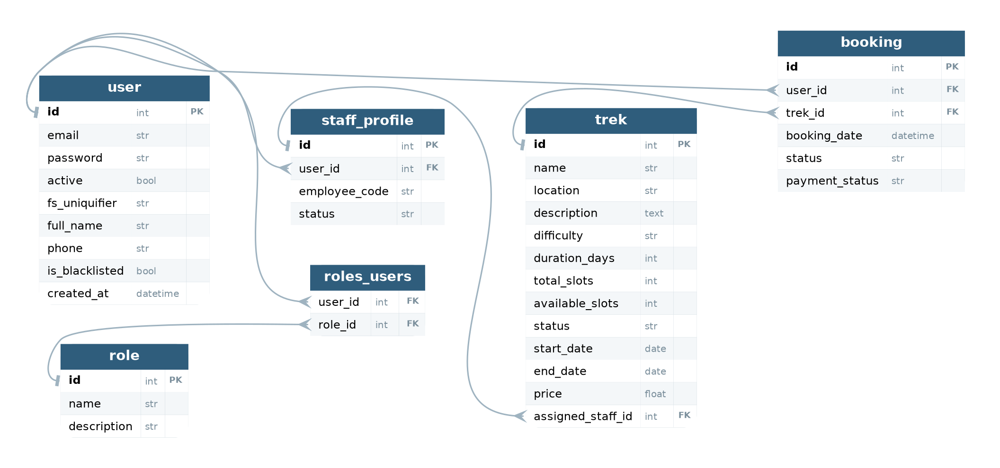

# Trekking Management Application — V2

**Modern Application Development II — Project Report, May 2026 Term**

| | |
| --- | --- |
| Name | Navon John Lukose |
| Roll number | 24F2003934 |
| E-mail | 24f2003934@ds.study.iitm.ac.in |
| Term | May 2026 |
| Repository | https://github.com/Navonjl/mad2-trekking-management (private) |

---

## Problem statement

Trekking groups run their trips on spreadsheets and phone calls, which makes
trek approvals, registrations, slot availability and booking records hard to
keep straight. The application gives three kinds of user one shared set of
data with different permissions over it. An admin creates trek routes, adds
staff, assigns staff to treks and oversees every user and booking. Trek staff
run only the treks assigned to them, setting slots and status and seeing their
participants. Trekkers register themselves, search what is on offer, book a
place and keep a history of where they have been.

## Approach

The application is a JSON API with a separate single-page front end. The same
data has to appear three different ways, so putting every rule in the API means
the browser cannot skip a check and the three dashboards are just three sets of
components reading one set of endpoints.

Four decisions account for most of the design.

**One user table for all three roles.** Admin, staff and trekker store the same
things, and differ only in what they may do. They share a `user` table, with
roles in a many-to-many join. Login is one code path instead of three, and a
role check is a decorator on the view. Fields only staff have, the employee
code and duty status, sit in a separate `staff_profile` table so they are not
NULL for every trekker.

**Rules as plain conditions.** The four booking rules from the problem
statement, that the trek must exist, be Open, have a free slot, and not already
be booked by this user, are four numbered `if` statements in `book_trek()`.

**One exception to that.** Taking a slot is not a plain `if`. Reading the
count, checking it, then subtracting one is three steps, so two people pressing
Book on the last slot can both pass the check. A single conditional `UPDATE`
decrements the count only while a slot is free and reports how many rows it
changed. Zero rows means the trek filled up first.

**Storing `available_slots` instead of counting bookings.** Counting means a
`COUNT` per trek on every listing. The stored number is changed in the same
request that creates the booking, so the two cannot drift.

## Frameworks and libraries

Only the frameworks named in the problem statement are used. Nothing else was
added on either side.

| Layer | Technology | Version |
| --- | --- | --- |
| API | Flask | 3.1.3 |
| ORM | Flask-SQLAlchemy / SQLAlchemy | 3.1.1 / 2.0.51 |
| Database | SQLite | — |
| Auth | Flask-Security-Too | 5.8.1 |
| Cache | Flask-Caching + Redis | 2.4.1 / 6.4.0 |
| Jobs | Celery + Redis | 5.6.3 |
| UI | Vue 3 + Vue Router | 3.5.40 / 5.2.0 |
| Styling | Bootstrap | 5.3.8 |
| Charts | Chart.js | 4.5.1 |
| Build | Vite | 8.1.5 |

No CORS library is needed: the Vite dev server proxies `/api` to Flask, so
every request is same-origin. No `python-dotenv` either; the `.env` file is
read by an eight-line function in `app/config.py` using the standard library.

Redis does two jobs across three logical databases: 0 is the Celery broker, 1
is the response cache, 2 is the Celery result backend.

## Database design

| Table | Key fields |
| --- | --- |
| `role` | id, name (admin / staff / user), description |
| `user` | id, email, password, full_name, phone, active, is_blacklisted, created_at |
| `roles_users` | user_id → user, role_id → role |
| `staff_profile` | id, user_id → user, employee_code, status |
| `trek` | id, name, location, description, difficulty, duration_days, total_slots, available_slots, status, start_date, end_date, price, assigned_staff_id → staff_profile |
| `booking` | id, user_id → user, trek_id → trek, booking_date, status, payment_status |

Relationships: `user` to `role` is many-to-many; `user` to `staff_profile` is
one-to-one and optional, since only staff have one; `staff_profile` to `trek`
and both `user` and `trek` to `booking` are one-to-many.

Constrained values: difficulty is Easy, Moderate or Hard; trek status is
Pending, Approved, Open, Closed or Completed; booking status is Booked,
Cancelled or Completed.

The `user` table also carries two-factor and WebAuthn columns that come from
Flask-Security's model mixin and are not used here. The schema is created by
`db.create_all()` in the `flask init-db` command, not by hand.

## API endpoints

Everything answers JSON. Every route except login and register needs an
`Authentication-Token` header.

**Authentication** — `POST /api/accounts/login?include_auth_token`,
`POST /api/accounts/logout`, `POST /api/register` (trekkers only),
`GET /api/me`, `PUT /api/profile`.

**Trekker** — `GET /api/treks` (filters `q`, `difficulty`, `location`,
`min_days`, `max_days`; cached in Redis), `POST /api/bookings`,
`GET /api/bookings`, `POST /api/bookings/<id>/cancel`,
`POST /api/exports/bookings`, `GET /api/exports/<task_id>`,
`GET /api/exports/download/<filename>`.

**Admin** — `GET /api/admin/stats` (cached); `GET POST /api/admin/treks` and
`PUT DELETE /api/admin/treks/<id>`; `PUT /api/admin/treks/<id>/assign-staff`;
`GET POST /api/admin/staff`; `GET /api/admin/users`;
`POST /api/admin/users/<id>/{deactivate,reactivate,blacklist,unblacklist}`;
`GET /api/admin/bookings`; `POST /api/admin/bookings/<id>/mark-paid`.

**Trek staff** — `GET /api/staff/dashboard`, `PUT /api/staff/treks/<id>`,
`GET /api/staff/treks/<id>/participants`. Each checks the trek is assigned to
the caller and answers 403 otherwise.

Deactivating blocks login; blacklisting lets the user log in but refuses
booking, cancelling and exporting.

## Background jobs

| Job | Trigger | What it does |
| --- | --- | --- |
| `send_daily_reminders` | daily, 18:00 | messages every trekker booked on a trek starting within three days, with the date and joining instructions. Posts to a Google Chat space through an incoming webhook, or e-mail if none is set |
| `send_monthly_activity_report` | 1st, 06:00 | HTML report of the previous month (treks conducted, users who took part, the five most popular) e-mailed to the admin |
| `export_bookings_csv` | user, from their dashboard | writes that trekker's history to CSV and alerts them when it is ready |

The Celery instance is created in `app/celery_utils.py` and configured from the
`CELERY` block in `app/config.py`. A small `FlaskTask` base class runs each
task inside an application context, which is why the tasks use `db.session`
directly.

## Additional features

Redis caching on the trek listing with a 60-second expiry, cleared whenever a
trek changes, and skipped for admin and staff because the cache key does not
include the role. A Chart.js bar chart of the most popular treks on the admin
dashboard. Google Chat notifications for the reminder job. Payment recording on
a booking. HTML5 validation on the forms with matching checks in the API. A
Bootstrap layout that works at phone width. A `flask seed-demo` command that
loads staff, treks, trekkers and bookings so the application can be shown
straight away.

## Video presentation

**Drive link:** _[to be added]_
