# CHAPTER 1 | INTRODUCTION

Small trekking operators in India run their trips on spreadsheets, messaging groups and phone calls. Trek approvals, registrations, the number of free places and payment records live in different places and drift apart, so places get double-booked and nobody holds a reliable list of who is on a trek that leaves the next morning. Head in the Clouds is a web application that replaces this with one shared set of records and three roles over it. An administrator publishes trek routes and manages staff and users, trek staff run the treks assigned to them, and trekkers search for treks, book a place, cancel, and export their trekking history.

The reason to move this application to the cloud lies in its load pattern. Demand is sharply seasonal. An operator sees almost no traffic for weeks and then a burst of concurrent bookings in the minutes after a popular route opens. A single hand-configured server is either idle and paid for, or too small at exactly the moment it matters, and it fails as one unit during the only window that brings in revenue. Running the application on Microsoft Azure lets the stateless part of the system grow and shrink with demand, puts the data in managed services that are backed up and patched by the provider, and makes the whole environment reproducible from scripts instead of being built by hand.

The project uses the following cloud features: managed Kubernetes for orchestration and autoscaling, a managed relational database reachable only over a private network, a managed in-memory cache, a managed message queue with dead-lettering, serverless functions for scheduled work, object storage for the static front end and generated files, a secrets vault read through workload identity so that no credential is stored in the application, a managed ingress controller with automatic TLS certificates, and Azure Monitor for logs, metrics and alerts [1]. Table 1.1 maps each concern of the application to the Azure service that handles it.

Table: Table 1.1: Application concerns and the Azure services used
| Concern | Azure service | Cloud feature used |
| --- | --- | --- |
| Compute | Azure Kubernetes Service (AKS) | container orchestration, horizontal pod autoscaling, cluster autoscaling |
| Relational data | Azure Database for PostgreSQL flexible server | managed database, private VNet access, automated backups |
| Cache and job results | Azure Managed Redis | managed in-memory store over TLS |
| Background jobs | Azure Service Bus | managed queue, at-least-once delivery, dead-letter subqueue |
| Scheduled jobs | Azure Functions | serverless timer triggers |
| Front end and exports | Azure Blob Storage | static website hosting, time-limited signed URLs |
| Secrets and identity | Azure Key Vault, Microsoft Entra Workload ID | secret storage, keyless federated identity for pods |
| Public entry point | AKS application routing add-on | managed NGINX ingress, TLS, rate limiting |
| Images | Azure Container Registry | private image registry |
| Operations | Azure Monitor, Log Analytics | container logs, platform metrics, alert rules |

## 1.1 Objectives

- To build the trek booking application as a stateless JSON API and a single-page front end, so that any number of identical copies can serve requests.
- To provision the complete Azure environment from the Azure CLI, with private networking for the database and no secret stored in code or images.
- To containerise the application and run it on AKS with health checks, rolling updates and autoscaling driven by CPU load and by queue length.
- To move slow and scheduled work onto a managed queue and serverless timers, so that no single process in the cluster has to stay alive.
- To describe the same infrastructure as Bicep code and verify it against the live deployment.
- To measure the deployment: booking correctness under concurrency, response latency, autoscaling behaviour, release time and platform metrics.

## 1.2 Scope and constraints

The deployment runs in the Central India region on an Azure for Students subscription. That offer limits the subscription to six virtual CPUs per region, restricts several virtual machine sizes, and does not allow Azure Front Door or ACR Tasks. The design takes these limits as given. Every component is still an Azure service, and each one uses its free tier where Azure offers one, so the lab environment differs from a production deployment only in sizes.

# CHAPTER 2 | METHODOLOGY

The work proceeds in two pipelines. The provisioning pipeline creates the Azure environment once, in five ordered stages, and a sixth stage checks the result against an infrastructure-as-code description. The release pipeline then runs for every change to the application: it builds a container image, publishes the front end, and rolls the new version onto the cluster without downtime. Fig. 2.1 shows the system that results, Fig. 2.2 the provisioning stages and Fig. 2.3 the release pipeline. Each stage is described in its own section below.

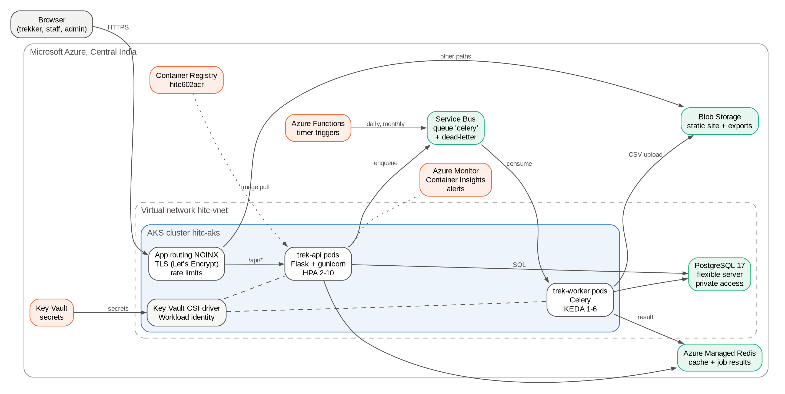{width=6.4}

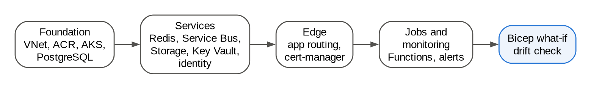{width=6.4}

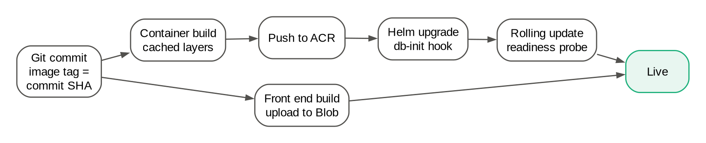{width=6.0}

## 2.1 Application design

The back end is a Flask [14] JSON API and the front end a Vue 3 single-page application. Authentication uses a bearer token issued at login instead of a server-side session, which is what lets any copy of the API serve any request. All three roles share one user table, with roles held in a many-to-many join and checked on every route. Configuration is read entirely from environment variables, with defaults that run the application on a laptop, so the same code runs locally and in the cluster.

The one rule that needed care is taking the last free place on a trek. Reading the count, checking it and writing it back are three steps, and two requests on two different servers can both pass the check. The booking is therefore a single conditional update in the database that decrements the free count only while it is above zero and reports how many rows it changed. Zero rows means the trek filled first. Correctness then rests on the database's row locking and holds no matter how many API copies are running.

## 2.2 Containerisation

One container image serves both the API and the background worker; the orchestrator chooses the command. The image is built on a slim Python base, installs the locked dependency set before copying the application code, and runs as a non-root user. Ordering the layers this way means a change to the code alone rebuilds and uploads only one small layer, while the dependency layer is reused until the lock file changes. Because ACR Tasks is not available on the subscription, the image is built locally with Podman and pushed to Azure Container Registry with a short-lived token issued by the Azure CLI.

## 2.3 Infrastructure provisioning

The environment is created by five shell scripts that call the Azure CLI, run in order: foundation (resource group, virtual network, registry, log workspace, AKS and PostgreSQL), services (Redis, Service Bus, storage, Key Vault, managed identity and secrets), deployment, edge, and jobs with monitoring. Each script records every command and Azure's reply in a log with generated secrets masked, checks whether a resource already exists before creating it so that it can be re-run safely, and runs the slow resources (AKS and PostgreSQL) in parallel. Resource names, sizes and the region are defined once in a shared configuration file.

## 2.4 Networking and data services

All resources sit in one virtual network in Central India. AKS nodes take a subnet of their own and use Azure CNI in overlay mode. PostgreSQL is placed in a second subnet delegated to it, with a private DNS zone linked to the network, so it has no public endpoint and is reachable only from inside the network [5]. Azure Managed Redis is reached over TLS on its own endpoint [6]. The Service Bus queue allows five delivery attempts before a message moves to the dead-letter subqueue [7], and the storage account serves the built front end as a static website and keeps generated exports in a private container with a lifecycle rule that deletes them after seven days.

## 2.5 Secrets and identity

Connection strings and keys are written once to Key Vault, which uses Azure role-based access control. A user-assigned managed identity holds two roles: reading secrets from the vault, and reading and writing blobs in the storage account. A federated credential tells Microsoft Entra ID to trust tokens that the cluster's OIDC issuer mints for one Kubernetes service account in one namespace. Pods running under that account exchange their token for an Entra token of the identity [2], the Secrets Store CSI driver uses it to mount the vault's secrets as environment variables [3], and the application uses the same identity to upload exports and sign download links. No password or key appears in the image, the Helm chart or the cluster configuration.

## 2.6 Orchestration and autoscaling

The application is packaged as a Helm chart with three workloads. The API Deployment runs between two and ten replicas under a HorizontalPodAutoscaler that targets 70 percent CPU utilisation [10]; a readiness probe on the health endpoint, which fails when the database is unreachable, keeps a pod out of rotation until it can serve. The worker Deployment is scaled by KEDA on the length of the Service Bus queue, between one and six replicas [11], because a worker waiting on a queue uses no CPU and CPU-based scaling would never react. A Job run as a Helm hook creates the database schema before each release [15], and a PodDisruptionBudget keeps at least one API pod running during node maintenance. The HorizontalPodAutoscaler and KEDA compute the desired replica counts as in equations (2.1) and (2.2), and the cluster autoscaler adds a node, up to two, when pods cannot be scheduled.

EQ: desired API replicas = ceil( current replicas x current CPU utilisation / 70% ) | (2.1)

EQ: desired worker replicas = ceil( messages waiting in the queue / 5 ) | (2.2)

## 2.7 Ingress and TLS

The AKS application routing add-on provides a managed NGINX ingress controller [4]. The chart creates a controller of its own with a public load balancer and a DNS name under cloudapp.azure.com, and cert-manager obtains a free certificate for that name from Let's Encrypt [12]. Requests under /api go to the API service. All other paths are proxied to the static website in Blob Storage, and page routes are rewritten to the application's index page so that deep links load. Because the browser sees one origin for both, no cross-origin configuration is needed. Two rules limit login attempts to 20 and booking requests to 30 per minute from one client address [17], in place of the web application firewall that Front Door would have provided.

## 2.8 Background and scheduled jobs

Three jobs run on Celery workers. A CSV export is started by a trekker from their dashboard, written by a worker to Blob Storage and handed back as a signed read-only link that expires after fifteen minutes. A daily reminder message goes to every trekker whose trek starts within three days, and a monthly activity report goes to the administrator. Instead of a scheduler process inside the cluster, which would be a single point of failure, two Azure Functions with timer triggers place the daily and monthly jobs on the Service Bus queue [8]. The Function app reads the queue's address from Key Vault with its own managed identity. Since the queue delivers each message at least once, every task is written so that running it twice gives the same result [13].

## 2.9 Release pipeline

A release takes the current Git commit identifier as the image tag, builds and pushes the image, and in parallel rebuilds and uploads the front end only if its files changed. A Helm upgrade then sets the new tag. Kubernetes replaces the API pods one at a time, starting each new pod and waiting for its readiness probe before stopping an old one, so the site keeps serving throughout. The release ends with a health check through the public address and reports its total duration. Tagging images by commit means any earlier release can be restored with a Helm rollback.

## 2.10 Monitoring and alerting

Container Insights sends pod logs and metrics to a Log Analytics workspace whose daily ingestion is capped to stay within the free monthly allowance. PostgreSQL, Service Bus and AKS publish platform metrics to Azure Monitor. Four alert rules notify an action group by e-mail: any dead-lettered message, a queue backlog above 50 messages, database storage above 80 percent, and node CPU above 80 percent.

## 2.11 Infrastructure as code verification

The same infrastructure is described in a Bicep template: the network and private DNS zone, registry, log workspace, AKS, PostgreSQL, Redis, Service Bus, storage, Key Vault, managed identity with its federated credential, and the alerts. The template is compiled, validated against the resource group, and compared with the live resources using a what-if operation, which reports what a deployment of the template would create, change or delete without changing anything [9].

# CHAPTER 3 | RESULT ANALYSIS

This chapter presents the deployed system and the measurements taken on it. The environment was built from scratch by the provisioning scripts on 26 October 2026: the foundation stage took 9 minutes 43 seconds, mostly waiting for AKS and PostgreSQL, the services stage 16 minutes 46 seconds, dominated by Azure Managed Redis, and the first deployment 2 minutes 17 seconds. All measurements below were taken on that environment, at https://hitc602.centralindia.cloudapp.azure.com.

## 3.1 Cloud infrastructure

Fig. 3.1 lists the resources in the resource group as reported by the Azure CLI. Every component in Table 1.1 is present, together with the private DNS zone and its network link that give PostgreSQL its private address. Fig. 3.2 shows the cluster running Kubernetes 1.36 on Standard_B2s_v2 nodes, with KEDA, workload identity and the application routing add-on enabled. The cluster autoscaler had already grown the node pool to two nodes, because the system add-ons alone request more CPU than one two-core node offers. Fig. 3.3 shows that PostgreSQL 17 runs on the free-tier B1ms size with public network access disabled.

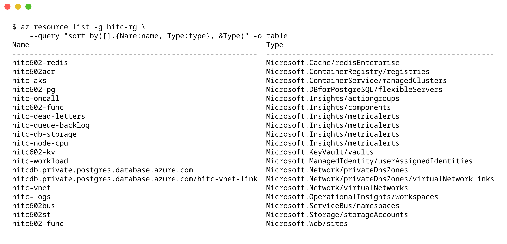{width=6.2}

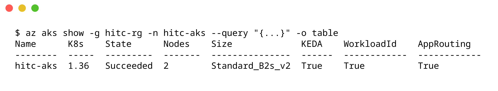{width=6.2}

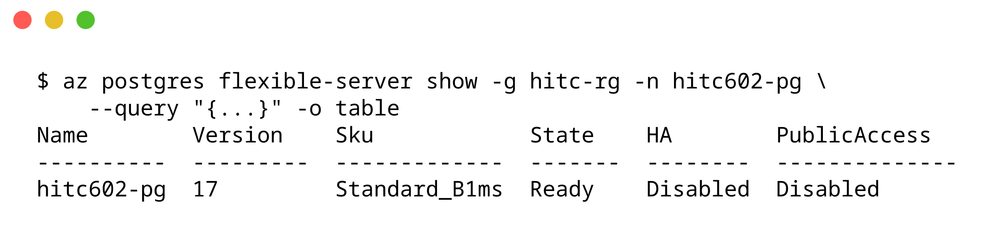{width=6.2}

Fig. 3.4 shows the eight secrets held in Key Vault. None of them appears in the repository, the container image or the Helm values; the pods receive them through the Secrets Store CSI driver after authenticating as the workload identity.

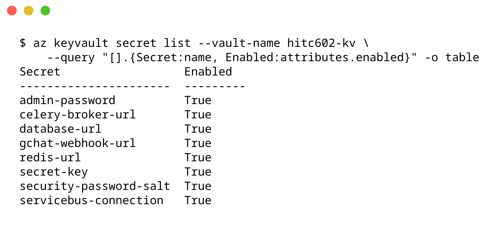{width=4.8}

## 3.2 Containerisation and orchestration

Fig. 3.5 shows the application's Deployments and autoscalers. The API runs two replicas under a HorizontalPodAutoscaler at about 1 percent CPU against its 70 percent target, and the worker runs one replica under the HorizontalPodAutoscaler that KEDA creates from its ScaledObject on the Service Bus queue. Fig. 3.6 shows the running pods, the internal API service, the ExternalName service that points the ingress at Blob Storage, and the five ingress rules on the public host name. Fig. 3.7 shows the Let's Encrypt certificate issued by cert-manager and a health check over HTTPS through the ingress.

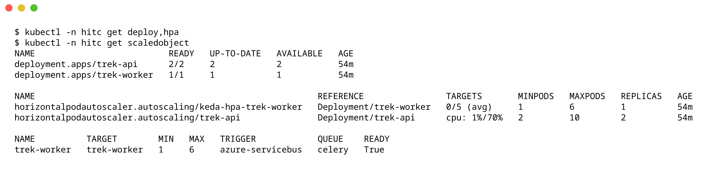{width=6.2}

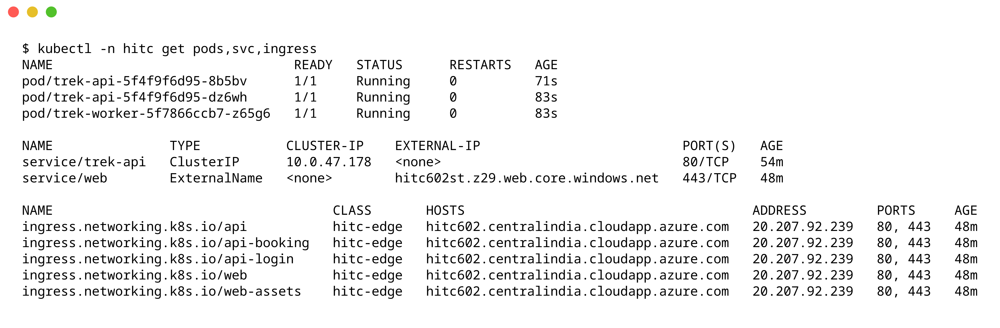{width=6.2}

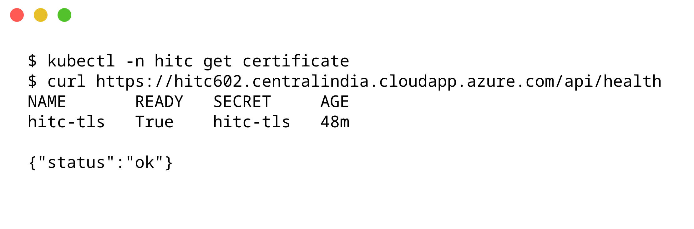{width=6.2}

## 3.3 Automation with Git and GitHub Actions

Every push to the main branch that touches the application runs the workflow in Fig. 3.8. The test job installs the locked dependencies, initialises a SQLite database, checks the health endpoint and a login, and builds the front end. The deploy job then signs in to Azure over OIDC as a managed identity that trusts only this repository's production environment, so the repository stores no password. It pushes an image tagged with the commit identifier, publishes the front end and runs the Helm upgrade. In the run shown, the test job took 29 seconds and the deploy job 2 minutes 30 seconds. The two failed runs below it exposed an action version without a floating tag and a federated credential that did not match GitHub's new subject format, which includes the owner and repository IDs; both were fixed by the commits in Fig. 3.9. Fig. 3.9 shows that the image tags in the registry correspond to commits in the Git history, so any release can be traced to its source and rolled back with Helm.

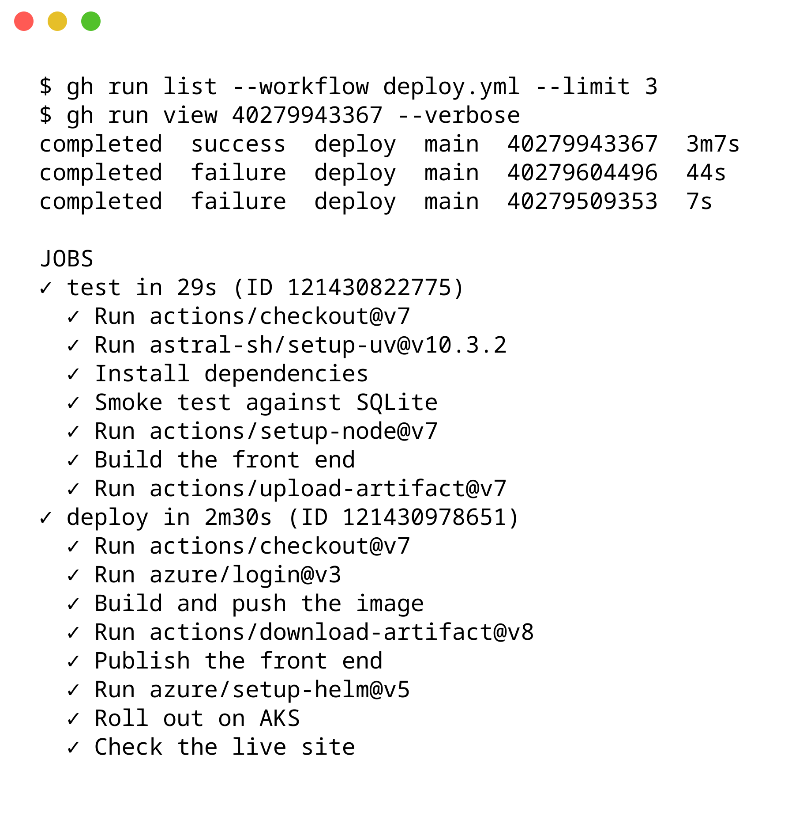{width=4.3}

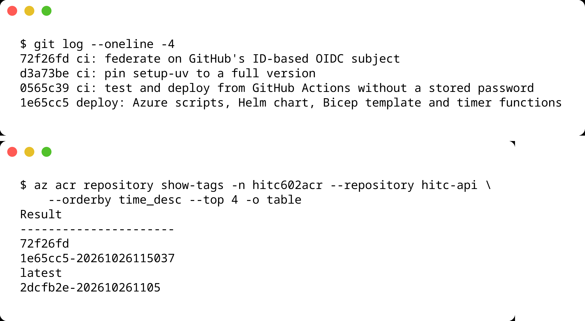{width=5.4}

## 3.4 Application features

Figs. 3.10 to 3.14 show the application as served from Azure. Trekkers browse open treks with their difficulty, price, dates and remaining places, and export their booking history; the export runs as a background job and the download link points straight at Blob Storage. The administrator's dashboard counts treks, trekkers, staff and bookings and charts the most booked treks; the trek created by the concurrency test in Section 3.5 leads that chart with its ten bookings. Staff see only the treks assigned to them.

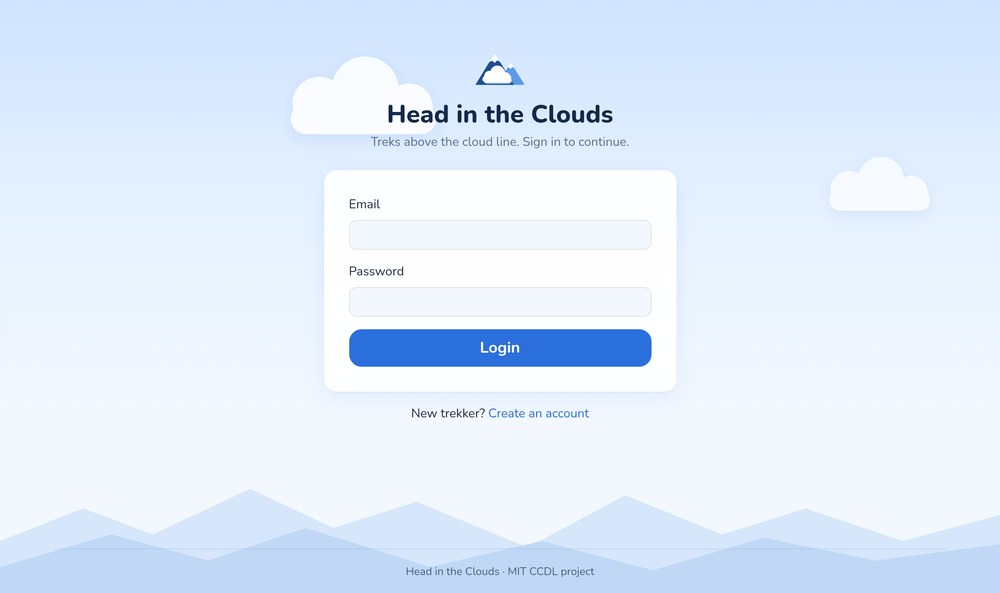{width=5.6}

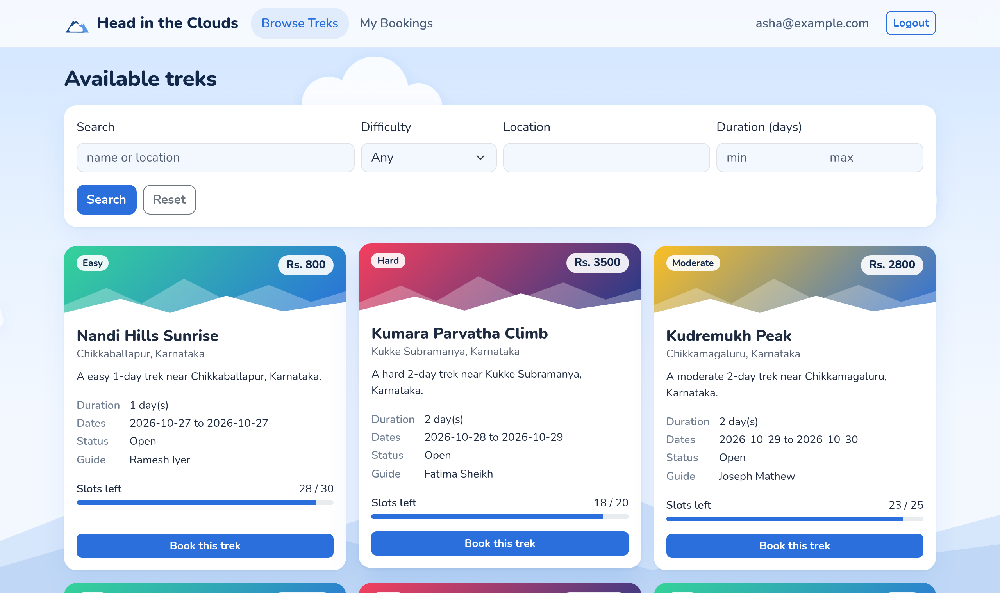{width=5.6}

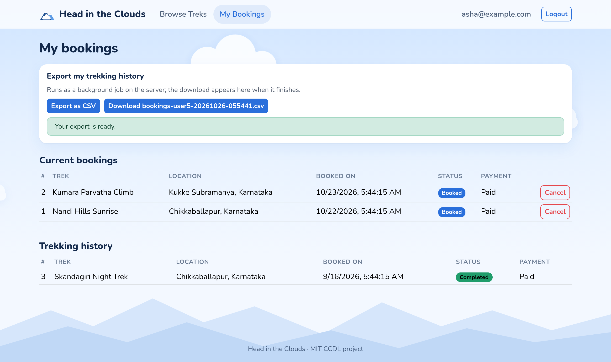{width=5.6}

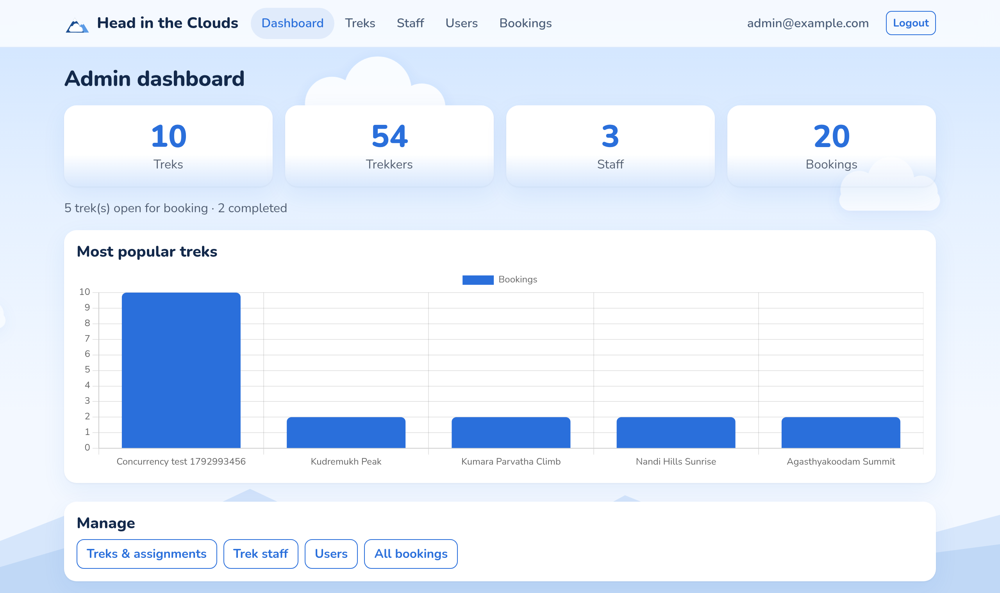{width=5.6}

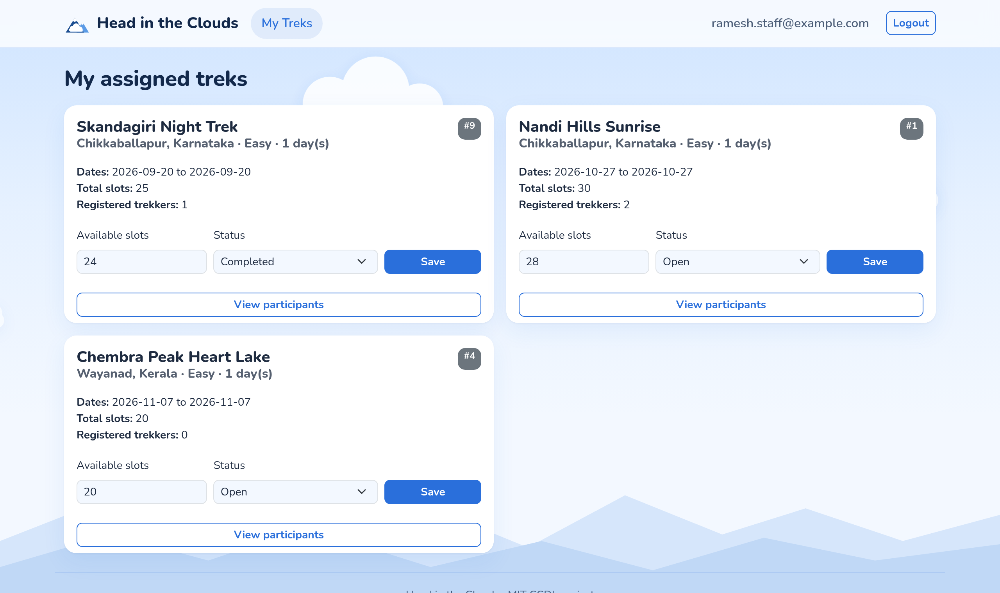{width=5.6}

## 3.5 Booking correctness under concurrency

Fifty newly registered trekkers sent a booking request for the same trek at the same instant, released together by a barrier, from inside the cluster through the API service so that the requests spread across both API replicas. The trek had ten places. Fig. 3.15 shows the outcome: exactly ten bookings were accepted, the other forty were refused with the message that the trek was full, and the trek ended with zero places left. Nothing was oversold, which confirms that the single conditional update in Section 2.1 holds across replicas. The booking responses took between 71 and 410 milliseconds, with a median of 301 milliseconds, while fifty requests competed for the same database row.

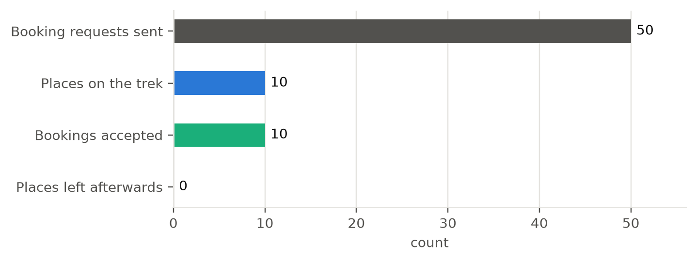{width=5.6}

## 3.6 Response time through the public address

Three request types were each sent 300 times, ten at a time, from a client in Karnataka to the public HTTPS address: a front-end page proxied from Blob Storage, the health check that queries PostgreSQL, and the trek listing served from the Redis cache. Fig. 3.16 gives the percentiles and Table 3.1 the figures. All 900 requests succeeded.

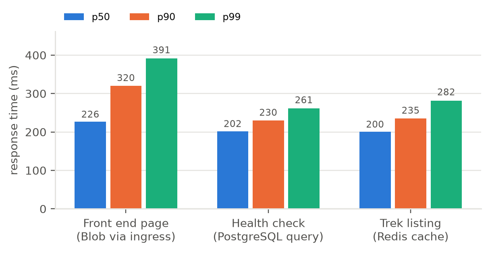{width=5.6}

Table: Table 3.1: Response time over 300 requests per endpoint (milliseconds)
| Request | Median | 90th percentile | 99th percentile | Mean |
| --- | --- | --- | --- | --- |
| Front end page (Blob through the ingress) | 226.5 | 320.1 | 391.4 | 243.9 |
| Health check (PostgreSQL query) | 201.9 | 229.9 | 261.3 | 203.9 |
| Trek listing (Redis cache) | 200.4 | 235.3 | 281.9 | 202.0 |

Most of this time is network. A separate measurement found 62 milliseconds to open the TCP connection, 125 milliseconds until TLS was established and 178 milliseconds until the first byte of the health check arrived. Each test request opened a new connection, so roughly three network round trips, about 190 milliseconds, are included in every figure, and the work done by the application is a few milliseconds per request. The front-end page is the slowest and the most variable because the ingress makes a second HTTPS request to Blob Storage for it.

## 3.7 Rate limiting at the ingress

Thirty login attempts with a wrong password were sent in quick succession. The first 25 reached the application and were rejected with HTTP 400, and the remaining five were refused by NGINX with HTTP 503 before reaching any pod. The limit is 20 per minute; five more requests passed because the allowance refills continuously at that rate while the 30 attempts were being sent.

## 3.8 Queue-driven autoscaling

A Kubernetes Job of four pods placed 3,000 CSV export jobs on the Service Bus queue at once, while the queue length and the worker replica count were sampled every ten seconds. Fig. 3.17 shows the result. The queue peaked at 2,644 messages 25 seconds after the start. KEDA raised the worker count from one to four at that point and to the maximum of six eleven seconds later, as equation (2.2) predicts for a queue of that length. The six workers emptied the queue within 59 seconds of the start, a throughput of about 50 exports per second. KEDA kept the workers for its five-minute cooldown and then returned the deployment to one replica. Every requested replica started, so the two nodes had capacity for the full scale-out.

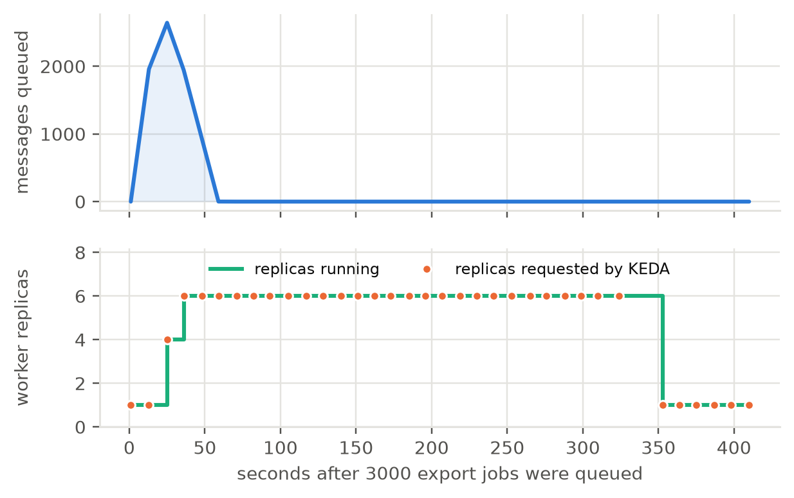{width=5.6}

## 3.9 Release time

Fig. 3.18 breaks down one release made with the rollout script. Building the image took 8 seconds and pushing it 3 seconds, because only the application layer had changed and the dependency layer was reused. The Helm upgrade took 38 seconds, which includes the schema job and replacing the two API pods one at a time behind their readiness probe. The final health check through the public address took 6 seconds, and the front end was rebuilt and uploaded in parallel. The release completed in 55 seconds, well within the five-minute target.

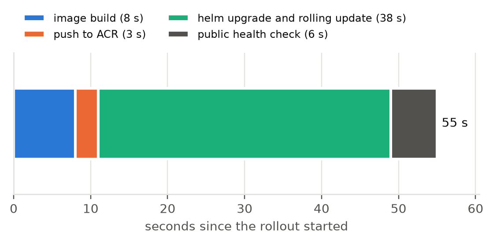{width=5.6}

## 3.10 Monitoring and infrastructure as code

Fig. 3.19 plots three platform metrics from Azure Monitor across the 37-minute test window. The Service Bus series shows the 3,000 messages of the autoscaling test arriving within one minute. Average node CPU peaked at 28 percent while the six workers drained the queue, and PostgreSQL CPU stayed below 14 percent throughout, so neither the nodes nor the database were close to saturation. Fig. 3.20 shows the timer functions and Fig. 3.21 the four alert rules.

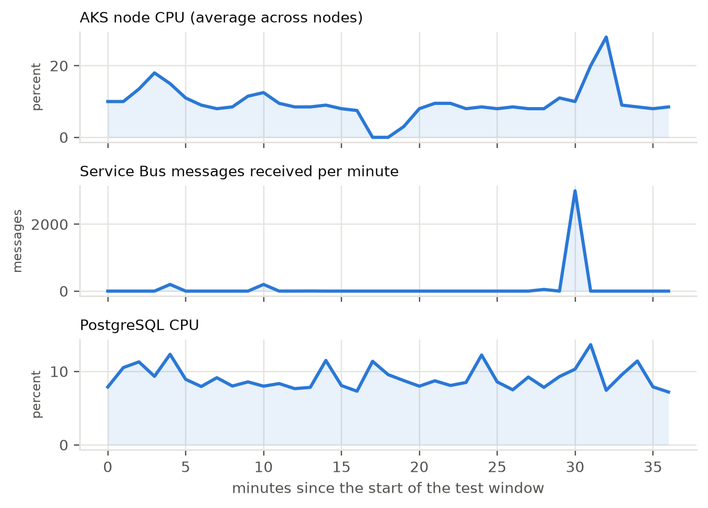{width=5.6}

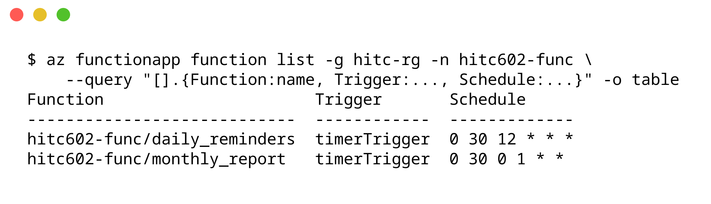{width=6.0}

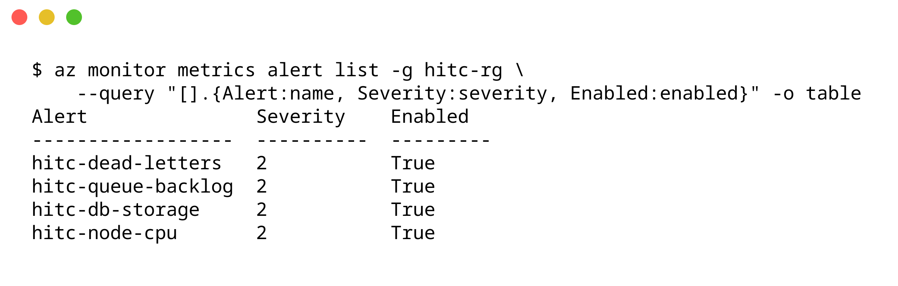{width=4.8}

Validating the Bicep template against the resource group succeeded, and the what-if comparison in Fig. 3.22 found nothing to create and nothing to delete among the 23 resources the template declares. Of the nine resources reported as modified, only the AKS node count carries a real difference: the template states the starting count of one, and the autoscaler has since raised it to two. The other entries are default values that Azure filled in and the template leaves unset. The six ignored resources are those the template does not declare, such as the Function app and the identity used by GitHub Actions.

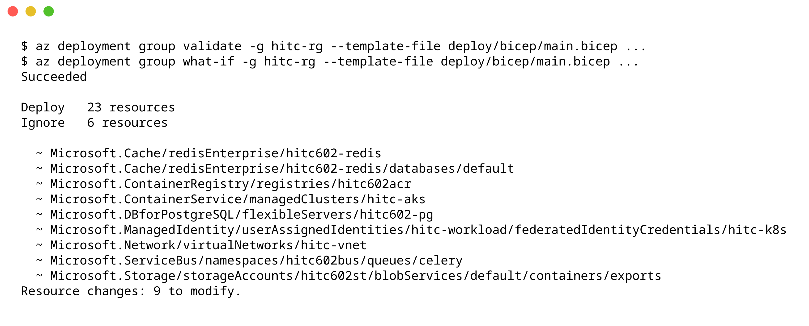{width=6.2}

## 3.11 Summary against the objectives

Table 3.2 relates each objective in Section 1.1 to the result that addresses it, and Table 3.3 gives the cost of the environment.

Table: Table 3.2: Objectives and results
| Objective | Result |
| --- | --- |
| Stateless API and single-page front end | two API replicas served all traffic interchangeably; 900 of 900 test requests succeeded |
| Environment from the Azure CLI, private database, no stored secrets | built by scripts in about 30 minutes; PostgreSQL has no public access; eight secrets live only in Key Vault |
| Containers on AKS with health checks, rolling updates and autoscaling | zero-downtime release in 55 seconds; workers scaled from one to six on queue length and back |
| Slow and scheduled work on a queue and serverless timers | 3,000 jobs processed in under a minute; scheduled jobs dispatched by Azure Functions |
| Infrastructure described as Bicep and verified | validation succeeded; what-if found no resource to create or delete |
| Measured behaviour | no overselling under 50 concurrent bookings; about 200 ms median response including network |

Table: Table 3.3: Cost of the lab environment (Central India list prices [16])
| Resource | Tier | Approximate cost |
| --- | --- | --- |
| AKS control plane and application routing | Free | none |
| AKS nodes, Standard_B2s_v2 | two nodes while running | 0.090 USD per node-hour |
| PostgreSQL B1ms, 32 GB | 12-month free services | none |
| Azure Managed Redis | Balanced B0 | 0.017 USD per hour |
| Container Registry | Basic | 0.167 USD per day |
| Functions | Flex Consumption | within the monthly free grant |
| Log Analytics | 0.15 GB daily cap | within the free 5 GB per month |
| Service Bus, Blob Storage, Key Vault | Basic and Standard | a few cents |

With two nodes the environment costs about five US dollars a day. Stopping the cluster and the database between demonstrations removes most of that, and the scripts recreate the whole environment when it is next needed.

# CHAPTER 4 | CONCLUSION

The project moved a trek booking application onto Microsoft Azure as a set of managed services around a Kubernetes cluster, and every objective set in Chapter 1 was met on the running system. The environment is created from the Azure CLI by scripts that can be rerun safely, the same infrastructure is described in Bicep and checked against the live resources, and a push to the main branch reaches production through GitHub Actions without any password stored in the repository. The measurements show the design doing what it was built for. Fifty simultaneous bookings for ten places produced exactly ten bookings, because correctness rests on one conditional update in the database rather than on the number of servers. A backlog of 3,000 jobs made KEDA scale the workers from one to six and clear the queue in under a minute, after which the workers scaled back. A release took 55 seconds with no downtime, and response times of about 200 milliseconds were dominated by the network distance to the region rather than by the application. The results also show the limits of the lab environment. The Azure for Students subscription does not allow Front Door or ACR Tasks, so the edge is the AKS application routing add-on with rate limits in place of a web application firewall, and images are built outside Azure. Its six-CPU quota caps the cluster at two small nodes, and the system add-ons alone need more than one of them, which is why the cluster ran two nodes even when idle and why load tests beyond the six-worker limit were not possible. Response times were measured from a single client, and the database ran without high availability on its free-tier size, so the failover behaviour of a production database was not tested. Future work follows from these limits: on a pay-as-you-go subscription the optional Front Door script adds the managed edge and its firewall, PostgreSQL can run zone-redundant with a standby in a second zone, and the cluster can use larger or spot nodes with the node auto-provisioner. Further steps are a load test from several regions, distributed tracing across the API, queue and workers, and a staging environment that the workflow deploys to before production.

# REFERENCES |

[1] Microsoft, "What is Azure Kubernetes Service (AKS)?," Microsoft Learn. [Online]. Available: https://learn.microsoft.com/en-us/azure/aks/what-is-aks. Accessed: Oct. 26, 2026.
[2] Microsoft, "Use Microsoft Entra Workload ID with Azure Kubernetes Service (AKS)," Microsoft Learn. [Online]. Available: https://learn.microsoft.com/en-us/azure/aks/workload-identity-overview. Accessed: Oct. 26, 2026.
[3] Microsoft, "Use the Azure Key Vault provider for Secrets Store CSI Driver in an AKS cluster," Microsoft Learn. [Online]. Available: https://learn.microsoft.com/en-us/azure/aks/csi-secrets-store-driver. Accessed: Oct. 26, 2026.
[4] Microsoft, "Managed NGINX ingress with the application routing add-on," Microsoft Learn. [Online]. Available: https://learn.microsoft.com/en-us/azure/aks/app-routing. Accessed: Oct. 26, 2026.
[5] Microsoft, "Networking overview for Azure Database for PostgreSQL with private access," Microsoft Learn. [Online]. Available: https://learn.microsoft.com/en-us/azure/postgresql/flexible-server/concepts-networking-private. Accessed: Oct. 26, 2026.
[6] Microsoft, "What is Azure Managed Redis?," Microsoft Learn. [Online]. Available: https://learn.microsoft.com/en-us/azure/redis/overview. Accessed: Oct. 26, 2026.
[7] Microsoft, "Overview of Service Bus dead-letter queues," Microsoft Learn. [Online]. Available: https://learn.microsoft.com/en-us/azure/service-bus-messaging/service-bus-dead-letter-queues. Accessed: Oct. 26, 2026.
[8] Microsoft, "Timer trigger for Azure Functions," Microsoft Learn. [Online]. Available: https://learn.microsoft.com/en-us/azure/azure-functions/functions-bindings-timer. Accessed: Oct. 26, 2026.
[9] Microsoft, "Bicep deployment what-if operation," Microsoft Learn. [Online]. Available: https://learn.microsoft.com/en-us/azure/azure-resource-manager/bicep/deploy-what-if. Accessed: Oct. 26, 2026.
[10] The Kubernetes Authors, "Horizontal Pod Autoscaling," Kubernetes Documentation. [Online]. Available: https://kubernetes.io/docs/tasks/run-application/horizontal-pod-autoscale/. Accessed: Oct. 26, 2026.
[11] The KEDA Authors, "Azure Service Bus scaler," KEDA Documentation. [Online]. Available: https://keda.sh/docs/latest/scalers/azure-service-bus/. Accessed: Oct. 26, 2026.
[12] The cert-manager Authors, "HTTP01 challenge," cert-manager Documentation. [Online]. Available: https://cert-manager.io/docs/configuration/acme/http01/. Accessed: Oct. 26, 2026.
[13] Celery Project, "Tasks," Celery User Guide. [Online]. Available: https://docs.celeryq.dev/en/stable/userguide/tasks.html. Accessed: Oct. 26, 2026.
[14] Pallets Projects, "Flask Documentation." [Online]. Available: https://flask.palletsprojects.com/en/stable/. Accessed: Oct. 26, 2026.
[15] The Helm Authors, "Chart Hooks," Helm Documentation. [Online]. Available: https://helm.sh/docs/topics/charts_hooks/. Accessed: Oct. 26, 2026.
[16] Microsoft, "Azure Retail Prices REST API overview," Microsoft Learn. [Online]. Available: https://learn.microsoft.com/en-us/rest/api/cost-management/retail-prices/azure-retail-prices. Accessed: Oct. 26, 2026.
[17] The Kubernetes Authors, "Ingress-NGINX annotations: rate limiting," Ingress-NGINX Documentation. [Online]. Available: https://kubernetes.github.io/ingress-nginx/user-guide/nginx-configuration/annotations/. Accessed: Oct. 26, 2026.
