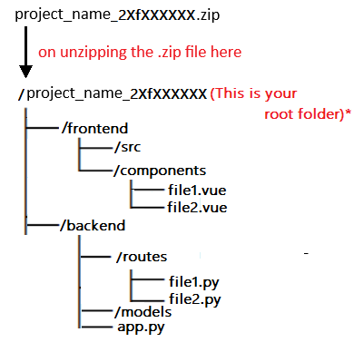

# Trekking Management Application - V2

Source: <https://docs.google.com/document/u/1/d/e/2PACX-1vSabfvSRC1BvxC5eNhzzj6PqBg1ATKq9nH_s_fVwOrG84-JNETkFkwienTgnmoAMSZZT9zsHdNwis4Y/pub>

---

Adventure organizations require efficient systems to manage trekking activities involving trek organizers, staff, and participants. Currently, many trekking groups rely on spreadsheets, calls, or manual coordination, which makes it difficult to manage trek approvals, participant registrations, slot availability, and booking tracking.

You are required to build a Trekking Management Application (TMA) web application that allows Admin, Trek Staff, and Users (Trekkers) to interact with the system based on their roles.

#### Frameworks to be used

These are the mandatory frameworks on which the project has to be built.

* Flask for API
* VueJS for UI
* VueJS Advanced with CLI (only if required, not necessary)
* Jinja2 templates if using CDN only for entry point (not to be used for UI)
* Bootstrap for HTML generation and styling (no other CSS framework is allowed)
* SQLite for database (no other database is permitted)
* Redis for caching
* Redis and Celery for batch jobs

Note:

* All demos should be possible on your local machine.
* Any other framework/library will not be allowed apart from those given above.
* The database must be created programmatically (via table creation or model code)
* Manual database creation  (e.g., DB Browser for SQLite) is NOT allowed.

---

### Roles & Functionalities

This platform has three roles:

1. #### Admin

Admin is the pre-existing superuser of the application.

* Can create, update and remove trekking routes
* Can add and manage trek staff
* Can assign staff to treks
* Can view and manage all users, staff, and treks
* Can search users, staff, or treks
* Can deactivate or blacklist users or staff
* Can view reports and trekking statistics.

2. #### Trek Staff

* Can log in only after being created by Admin
* Can view assigned treks by admin
* Can manage trek details such as:

* Available slots
* Trek status (Open / Closed)

* Can view list of registered users for their treks
* Can update trek completion status

3. #### User (Trekker)

* Can register, log in, and update their profile
* Can view approved/open treks
* Can search and filter treks based on difficulty, location, and duration
* Can book treks
* Can view booking status and trekking history

---

### Key Terminologies

1. #### Admin: A user with the highest level of access who manages the entire trekking system.
2. #### Trek Staff: A staff member responsible for managing and coordinating assigned treks.
3. #### User (Trekker): A participant who books and participates in trekking activities.
4. #### Trek: A trekking event created and managed in the system.

Attributes:

* Trek ID
* Trek Name
* Location
* Difficulty (Easy / Moderate / Hard)
* Duration (in days)
* Available Slots
* Assigned Staff ID
* Status (Pending / Approved / Open / Closed / Completed)
* Start Date
* End Date
* Extra fields etc.

5. #### Booking: A record of a user booking a trek.

Attributes:

* Booking ID
* User ID
* Trek ID
* Booking Date
* Status (Booked / Cancelled / Completed)
* Payment Status (Optional)
* Extra fields etc.

6. #### Staff Profile: Details of a registered staff member.

Attributes:

* Staff ID
* Name
* Contact Details
* Assigned Trek(s)
* Status
* Extra fields etc.

Note: The above tables and fields are not exhaustive. Students can add more/less tables and fields as required.

### Similar Apps

* [https://www.alltrails.com/](https://www.alltrails.com/)
* [https://www.thrillophilia.com/](https://www.thrillophilia.com/)
* [https://www.meetup.com/](https://www.meetup.com/)

### Application Wireframe

[mad2-trekking-wireframe.pdf](https://drive.google.com/file/d/12SS9SuAl364Sgx6TtxDn4Zjm8XsynwIO/view?usp=sharing)

Note:
The provided wireframe is intended only to illustrate the application's flow and demonstrate navigation.

* Replication of exact UI is NOT mandatory.
* Students are encouraged to design their own UI while maintaining the application's intended functionality and flow.

---

### Core Features

* #### Authentication

* Login/register for Users (Trekker)
* Login only for Admin and Trek Staff (no registration)
* Only one Admin must exist and should be created programmatically
* Role-based access control and authentication using Flask security (session or token) or JWT based Token.
* A unified user model to differentiate all types of user roles.

* #### Admin Functionalities

* Admin dashboard showing:

* Total number of treks
* Total number of users and staffs
* Total number of bookings

* Admin must pre-exist and be created programmatically after database creation. [No admin registration allowed]
* Admin can:

* Create and manage treks routes
* Add a new trek staff
* Assign staff to treks
* View all bookings
* Search users, staff, and treks
* Deactivate or blacklist users/staff

* #### Trek Staff Functionalities

* Staff dashboard should display:

* Assigned treks by admin
* Number of registered user per trek

* Staff can:

* Update trek slots and status
* View and manage participant list
* Mark trek as started/completed

* #### User Functionalities

* Users must self-register and log in
* User dashboard should display:

* Available treks
* Booked treks
* Trek status

* Users can:

* Book treks
* View booking status
* View trekking history
* Edit their profile
* Search treks

* #### Backend Jobs (Using Celery)

a. Scheduled Job – Daily Reminders - The application should send daily reminders to users on g-chat using Google Chat Webhooks or SMS or mail

* Send reminders to users about upcoming treks, including trek start date, instructions, etc.
* Can be sent via email, SMS, or webhook
* Runs daily at a chosen time

b. Scheduled Job – Monthly Activity Report - Devise a monthly report for the Admin created using HTML and sent via mail.

* Generate monthly trekking activity report for Admin
* Includes:

* Number of treks conducted
* Number of users participated
* Popular treks

* Generated on the first day of every month
* Sent to Admin via email (HTML or PDF)

c. User Triggered Async Job – Export Booking History as CSV

* Users can export their trekking history
* CSV should include:

* User ID
* Trek Name
* Location
* Booking Status
* Dates

* Triggered from user dashboard
* Export is triggered from the student dashboard.
* This should trigger a batch job, and send an alert once done.

* #### Performance and Caching

* Use Redis caching for:

* Frequently accessed treks

* Implement cache expiry
* Optimize API response times

* #### Other Core Functionalities

* Prevent overbooking beyond available slots
* Ensure only assigned staff can manage a trek
* Allow booking only when trek status is Open
* Prevent duplicate bookings for same trek
* Maintain complete trekking history per user
* Allow searching and filtering of treks
* Allow admin to view all historical trekking data

---

### Recommended and/or Optional Functionalities

* Well-designed PDF reports for Monthly activity reports (You can choose between HTML and PDF reports)
* Charts for analytics (popular treks, user participation) using ChartJS
* Single Responsive UI for both Mobile and Desktop

* Unified UI that works across devices
* Add to desktop feature

* Implementing frontend validation on all the form fields using HTML5 form validation or JavaScript
* Implementing backend validation within your APIs
* Provide styling and aesthetics to your application by creating responsive frontend using simple CSS or Bootstrap
* Notifications for booking confirmation/cancellation
* Basic payment simulation (optional)
* Any additional feature relevant to trekking systems

### Evaluation

1. Students have to create and submit a project report (not more than 5 pages) on the portal, along with the actual project submission
2. The report must include the following things;

1. Student details
2. Project details, including the question statement and how you approached the problem statement
3. AI/LLM Declaration
4. Frameworks and libraries used
5. ER diagram of your database, including all the tables and their relations
6. API resource endpoints (if any)
7. Drive link of the presentation video

3. If a student has used any form of AI/LLM for the project, you will need to mention the extent of use in your report, ([click here for the doc](https://docs.google.com/document/d/e/2PACX-1vQ2eIDqkr1CI-quwKWCGm7ADz-YDaq4UZwxYJ-SSrmrOsGo1yB4pESe9K8eXA95A0TYmcaEhK9MHVtJ/pub))
   Note: Usage of AL/LLM/coding agents will be considered only if students showcase basic understanding of the code submitted.
4. You can find a template to create the project report ([click here for project report demo](https://drive.google.com/drive/folders/1deHq6boskmEzp1sbUA-LfXQYRWBKG9_G?usp=sharing))

Possible folder structure:

5. All code is to be submitted on the portal in a single zip file (zipping instructions are given in the project document - Project Doc T12026

6. Video Presentation Guidelines (Advised):

1. A short intro (not more than 30 sec)
2. How did you approach the problem statement? (30 sec)
3. Highlight key features of the application (90 sec)
4. Any additional feature(s) implemented other than core requirements (30 sec)

Note:

1. The final video must not exceed 5-10 minutes.
2. Keeping your video feed on during recording (like in a screencast) is optional but recommended.

7. The video must be uploaded on the student drive with access to anyone with the link and the link must be included in the report:

1. This will be viewed during or before the viva, so it should be a clear explanation of your work.

8. Viva: After the video explanation, you are required to give a demo of your work, and answer any questions that the examiner asks:

1. This includes making changes as requested and running the code for a live demo.
2. Other questions may be unrelated to the project itself, but are relevant to the course.

### Instructions

1. This is a live document and will be updated with more details (wireframe)
2. We will freeze the problem statement on or before x/x/2026, beyond which any modifications to the statement will be communicated via proper announcements.
3. The project has to be submitted as a single zip file.
